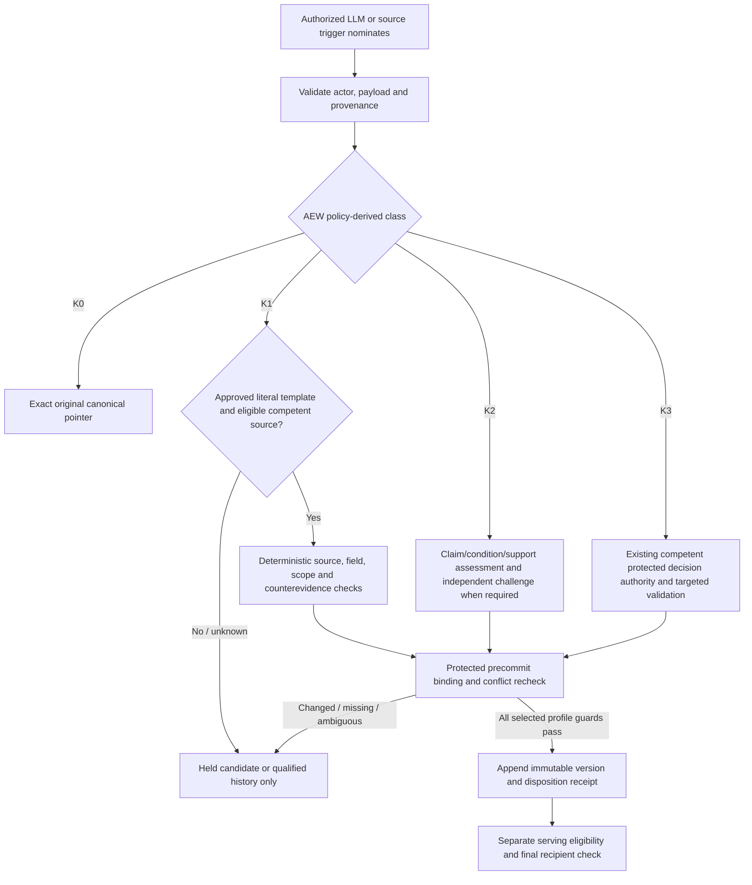
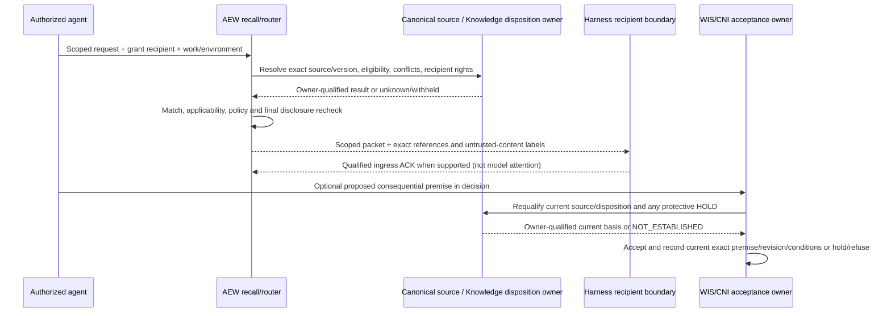

<!--
generated: do not edit; regenerated from the adopted design text (see README.md)
position: A-13
source: 10-adopted/RECONCILED-SOURCE-BASELINE/01-ADOPTED-SOURCE-BYTES/A-13__AEW-K01-Knowledge-Boundary-Contract-candidate-v0.3.3.md
source-sha256: 747d8554d1dbdaf7e0ce358e4cff3ab75c2b7d40d226f89371f597135243a9fa
edits-sha256: none
-->

# AEW K-01 — Knowledge Boundary Contract — Integrated Candidate v0.3.3

**Prepared:** 2026-10-17  
**Revision:** v0.3.3 narrowly refines v0.3.2 independent-assessor eligibility in response to an October 17 review, preserves the earlier October 16 reconciliation and guest-native VM clarification, retains all 49 K01 clause IDs, and does not authorize admission activation.  
**Status:** **PROPOSED NORMATIVE BOUNDARY — NOT OPERATOR-ADOPTED; NOT RUNTIME-QUALIFIED.**  
**Supersession proposed:** replaces *the K-01 v0.1 proposal* and integrates the recoverable v0.2.1 application-history amendment; it does **not** supersede an adopted contract or independently revoke the October 9 M6b design adoption. The complete intermediate K-01 v0.2 original was not recovered.  
**Architectural layer:** Tier-3 domain/boundary semantics. Its companion information-profile and tabletop cases are **candidate interoperability/conformance aids**, not an adopted HTTP interface or operational proof.

## 0. Normative construction and status

If the operator adopts this candidate, target-state requirements such as relevant proactive discovery remain binding architectural design obligations even while a profile is explicitly staged/inactive. An inactive profile does **not** claim the full target outcome has been delivered. **MUST** denotes a binding behavior for the stated supported profile/condition; **MUST NOT** denotes a prohibition including in staged profiles; **MAY** denotes a permitted implementation choice. A profile's requirements do not constitute activation. The operational requirement to keep previously effective authorization, confidentiality, containment, independence, and protected-effect controls continues regardless of K-01's status. No implicit approval arises from this document.

**Adopted constitutional anchors:** foundational `AEW-FR-18.a–e`, `19.a–d`, `20.a–d`, `21.a–d`, `22.a–e`, `38.a–c`; `PC-FR-01–06`; engineering umbrella; `WIS-07.d`, `WIS-05.g`, `WIS-07.f`; `CNI-02.d`, `CNI-07.b–c`; `AEV` evidence/independence and qualified determinations; `ADC` grants; `HEB` protected effects, identity and custody; `AOI-04`, `AOI-08.d`; D-01 v0.3.2 bounded read wire. Related research obligations are retained under their adopted owners. **LCO v0.2.1 is approved nonnormative discovery/design input** (especially LCO-16–19/36, GAP-03), not itself a normative contract or live conformance.

### 0.1 Governance crosswalk (no silent promotion or rollback)

| Source / decision | Established standing | K-01 treatment |
|---|---|---|
| Twelve pinned foundational/umbrella/domain/wire sources and separate operator adoptions | **Adopted normative**, subject to their exact scope | Govern original facts, grants, assurance, premise acceptance, disclosure, operator reads. K-01 only allocates the missing advisory Knowledge boundary. |
| October 9 operator decision: M6b Capture/Admission v0.4, Shared Semantics v0.4, Recall/Context Routing v0.3 and ADR-0013 | **Operator-adopted M6b design direction**, not a separately adopted rebaseline K-01 norm | Preserve broad safe lookup discoverability, narrow default payload, protected tool delivery, **post-delivery protective attention for already supplied context**, the required target of bounded proactive consultation without mandatory agent polling, project scope, stage separation, A/B-first evidence gates and advisory authority. This proposal makes the boundaries reviewable; unresolved divergences need explicit operator disposition. |
| October 9 designer rulings for tool delivery and reviewer independence | Historical implementation/design rulings under that direction; not a new grant source | Reuse protected supervisor-mediated tools; verifier/reviewer may inspect qualified objectives/diffs/findings but not implementer private reasoning by default. |
| Historical Knowledge Contract v0.4, Oct 2–4 research, historical K-series and implementation proposals | **Historical evidence/design**; no automatic rebaseline normative promotion | Useful source for source-class provenance, evaluation and qualification. Technology, automatic admission and permissive history access are not assumed approved for a new deployment. |
| K-01 v0.1; K-01 v0.2.1 amendment; both reviewer finding sets | **Proposed / review evidence**; neither adopted | Original 25 clause IDs retained below with bounded revisions; new APP clauses K01-26–40. Exact intermediate v0.2 bytes unavailable. |
| D-01 v0.3.2 minimum Journal path | **Adopted read interface** | Finalized *AEV-issued qualified adverse determinations* appear under original WIS/AEV identities. They are **not admitted Cases**, require no GAP-03 decision, and do not prove Knowledge delivery or benefit. |

**Reference deployment profile (operator clarified 2026-10-16):** AEW's harness/Lead is guest-native on a Rocky 8 VM, **not container-hosted**. Selected supporting MCP/tool services may use containers. A VM alone is not an integrity boundary between agent-controlled and supervisor/protected processes **inside the same guest**. This contract requires HEB-qualified distinct effective security principals or equivalent enforceable isolation for those boundaries; it neither mandates containers nor asserts such isolation has been qualified.

**October 16 operator direction, recorded separately from K-01 contract adoption:** any authorized LLM may nominate; routine manual Knowledge editing/moderation is not an initial product dependency; guarded-history-first and evidence-gated Case/Lesson progression are affirmed. The operator has **not** authorized a novel certifier role or selected GAP-03 issuer, first Case source class, K2/K3 decision delegation or specific rollout qualification thresholds. Those mechanisms are proposed below for review, not silently adopted.

**Reconciliation rule:** A material difference between this proposal and operator-adopted M6b *direction* (for example, APP feedback cannot influence default ranking until qualified) is an explicit candidate refinement, **not** a silent revocation. The operator must approve any material change to adopted direction; absence of approval retains current direction and safety restrictions, with new K-01 behaviors staged.

## 1. Outcomes, scope and intentionally independent paths

Knowledge makes source-backed engineering experience *cheap to discover, safe to interpret, revisable, and useful* to every authorized role. It must not become a competing source of project, work, assurance, research, or execution authority. Important paths are deliberately independent: (a) canonical project-authority lookup and qualified direct-history lookup do not require Case admission; (b) a research inquiry need not create a Ticket or Case; (c) a model may decline to consult Knowledge; (d) independent verification never gains evidential independence from a recalled implementer narrative; (e) APP collection is optional and does not gate ordinary work.

The profiles are **H** guarded source/history lookup (the first implementation and A/B comparison target); **C** evidence-bounded structured Cases; **L** conditional Lessons; **E** proactive discovery; and **APP** optional application observations/feedback/evaluation. “A” in experimental comparisons means *no recall*, **not** APP. C/L/E/APP effects are staged. A profile is active only for an explicitly adopted scope/policy and qualified subject and deployment. Search indexes, prompts, vector providers, memory plugins, website/CLI names or record storage layout are not authority owners.

## 2. Source, owner, consumer and trust model

| Information or decision | Canonical producer/authority | Consumers and prohibition |
|---|---|---|
| Requirement, accepted project scope, work/research decision, code/package, accepted premise and reverse dependency | Existing project/WIS and governing decision owner; CNI applies progression/impact | Knowledge cites exact version and qualification; it cannot adopt a premise, revise work or certify unaffected scope. |
| Raw attempt, check, assurance determination, source revision or research observation | Existing WIS/AEV/HEB/research owner and qualified evidence producer | H direct lookup, capture, evaluators and AOI projections; structural extraction never upgrades semantics. |
| Read actor, effective recipient, grant lineage, eligible visibility and custody | ADC/HEB and recipient/disclosure owner | Recall, admission, APP and AOI enforce it; no role string or request mode impersonates authority. |
| Advisory Knowledge admission, content version and append-only Knowledge dispositions | **PROPOSED** AEW-controlled bounded Knowledge admission issuer under operator-adopted policy; specific competence **GAP-03 OPEN** | Read/recall may consume only qualified outcomes. LLM, tool, API, website and indexer cannot self-admit or self-resolve conflict. |
| Search match/selection/preparation/acknowledged delivery | Qualified AEW recall/router or harness ingress observer **for its own observed boundary only** | APP/evaluation consume native event IDs; preparation is never delivery. |
| Structured citation from a consumer | Harness/protocol observer **only if** binding to the recipient invocation and exact item is qualified; otherwise agent prose | May qualify a citation observation, never adoption/benefit. |
| Agent comment, explanation, self-reported use | Authenticated actual author and assignment/lineage as **untrusted attributed narrative** | May nominate investigation, never observed action, independent evidence, grant or accepted reliance. |
| Accepted consequential reliance at decision time | WIS / governing decision acceptance owner as allocated by CNI-07.b and WIS-07.d | Impact/reassessment follows existing CNI/WIS/AEV ownership; APP not required. |
| Canonical verified work outcome, independent recheck, causal experiment outcome | AEV/WIS/other competent outcome owner; independent F19/evaluation issuer for comparative benefit | Summary references source-specific claim/basis. Successful work does not imply Knowledge caused it. |
| Qualified post-delivery exposure and protective attention | Qualified protected ingress/receipt producer for its observed recipient/invocation/packet boundary; source/disposition owner for withdrawal; CNI/authorized Lead attention path for reconciliation | Delivered context **before WIS acceptance** is not accepted reliance. Active/unmerged recipients must have owner-qualified attention after consequential change when receipts support exposure; unobserved delivery remains unknown, not absent. |
| Target proactive Knowledge trigger/eligibility | Qualified source/disposition change and scoped active-assignment/environment/failure signal owners; selected E policy assigns eligibility/ingress consumers | Relevant active assignments can receive bounded discovery without mandatory polling once E is qualified; no announcement to unrelated/unauthorized recipients, no implicit adoption. |
| Knowledge Qualification Summary and optional APP read views | **Derived projection** assembled from above under a designated AEW read/projection maintainer | No new truth authority. Every material facet cites owner/basis and recipient-qualified completeness; stale data downgrades/withholds. |

## 3. Exact semantic identities and exchange obligations

A source reference MUST identify the issuing domain/owner, subject kind and stable canonical subject ID, immutable record/version/fingerprint where available, qualified read/observation reference, and conditions relevant to its claim. A source with unknown revision or authenticity remains labeled unqualified; textual IDs alone are not globally comparable. A positive currentness claim must specify the competent owner's comparable epoch/closure and, where the claimed consistency requires it, an owner-issued freshness/fencing witness valid across the relevant admission or serving boundary. A local issuer transaction alone cannot attest another owner's concurrent state. Accepted engineering **work ID**, **accepted work revision**, package, attempt/invocation, root-grant lineage, accepted decision/premise record, and Knowledge content version are distinct referents.

An admitted item MUST have durable `knowledge_id`, immutable `content_version`/content digest, `record_kind` (Case/conditional Lesson, or a separately declared allowed kind), claim components, origin/author attribution, source and root-evidence bindings, observed/applicability/exclusion conditions, limits/unknowns, recipient disclosure scope, and versioned admission policy/source class. Mutable `knowledge_disposition` MUST be append-only, separately ordered for the subject and globally within its owner/epoch, and reference changes/conflicts and prior dispositions. Derived summaries and search results identify the exact item content version **and** the evaluated current disposition/policy versions. An original history item retains its source ID; do not mint a shadow Knowledge record merely to display it.

A source relation MUST distinguish `derived_from`, `supports`, `challenges`, `refines`, `supersedes_within_scope`, `references` and `accepted_premise_use`; proposal/similarity links are not qualified truth. Multiple records rooted in the same evidence, inherited prompt, author or grant lineage do not become independent corroboration by count. An absence/empty result is only complete over a producer-qualified enumerated source and entitlement closure, not over an arbitrary index scan.

Interoperable projections MUST carry source-owner/version/epoch, derivation input references/closure when claiming completeness, recipient basis, observed and assessed time, qualification status (`QUALIFIED`, `NOT_ESTABLISHED`, `UNKNOWN`, `STALE`, `CONTESTED`, `WITHHELD` as applicable), and reasons or safe omission. These are *semantic obligations*, not mandates for database tables or one universal wire. The attached candidate JSON Schema and examples define an **illustrative implementer-neutral exchange profile**, not a D-01 modification.

## 4. Core K-01 obligations — original IDs retained and integrated

### 4.1 Identity, admission and provenance

- **K01-01 — No authority laundering.** Knowledge and APP MUST NOT originate or change adopted requirements, scope, grant, tool permission, assurance PASS/HOLD, research finding qualification or CNI readiness; they reference owning facts with correct trust class. Canonical authority references MAY be returned directly without admission.
- **K01-02 — Distinct identities.** Raw historical source identity MUST survive every projection; admitted Knowledge IDs/content versions and append-only dispositions are distinct; references, historical views and application attempts cannot silently acquire Case or Lesson identity.
- **K01-03 — Claim-level provenance.** Every material Knowledge claim MUST retain exact source/evidence/root, issuer/authentication, author and claim conditions/limitations/conflicts, including correlated-origin deduplication; missing claim support MUST be explicit.
- **K01-04 — Bounded admission competence.** Every LLM within an eligible effective-recipient/assignment scope MAY nominate advisory Knowledge; no favored model is required. Until GAP-03 issuer/policy competence is expressly approved, generated items remain candidates. Positive K1 automatic admission additionally requires **host-qualified authenticity for that exact original source class**: agent-controlled execution must not be able to mint, alter or replace the owner record or the owner proof under the asserted competent producer identity, including through shared-login writable stores. The protected issuer's identity, source templates, class policy, and effective policy revisions MUST be outside agent-writable project/workspace configuration and guarded under HEB-01.i/HEB-03.j/HEB-03.m or equivalent qualified boundaries. A positive class must be refused as `HELD_UNQUALIFIED_SOURCE` while either source integrity or protected policy custody is unqualified. Judgment-bearing claims and source-class expansions need separately attributable competent authorization; no agent can self-publish through service credentials.

- **K01-05 — Independent assessor confidentiality.** Recall MUST preserve assessor independence, source provenance, and reviewer-visible canonical objective/diff/checks/findings while withholding current implementer private reasoning and verifier drafts except under separately authorized source-class disclosure. A different model repeating text is not corroboration.
- **K01-06 — Source-class eligibility.** Nomination labels cannot select admission class or lower validation requirements. Every positive K1 source class MUST identify the protected record writer/principal, issuer-verifiable integrity basis and actual-VM host qualification, exact extractable typed fields, source/record/coverage versions, template and policy custody, oracle ceilings, negative forgery/smuggling witnesses, recipient authorization and replay/idempotency. A well-formed record written by an agent in an agent-writable observer store is **not** an authenticated owner record. When writer identity, protected storage, attestation or policy binding cannot be qualified, only history/candidate/held status is available under its actual disclosure rights; no positive K1 standing.

- **K01-07 — Case literalness.** A deterministic Case MUST NOT infer cause, fix, intent, generalizable recommendation, other-environment validity, or verified engineering success from authentic typed observations; semantic claims require independently controlled Lesson qualification.
- **K01-08 — Conditional Lesson.** A default-served Lesson MUST preserve separately qualified support, known counterevidence and unresolved alternatives, applicability/exclusion and support roots, author, disposition and recipient conditions; positive similarity/admission alone MUST NOT enable serving.
- **K01-09 — Orthogonal lifecycle.** Admission, support, conflict, lifecycle/supersession, applicability and serving eligibility MUST remain distinct per exact version, with immutable historical content and append-only qualified disposition events; no scalar `trust`, `verified`, or popularity score replaces those dimensions.

### 4.2 Impact and disclosure

- **K01-10 — Challenge, exposure and scoped supersession.** Material qualified withdrawal, contradiction or narrowed applicability MUST preserve original history and trigger **two distinct** impact paths: (a) WIS/CNI governed accepted-premise dependents; and (b) where available, exact protected ingress delivery receipts for active invocations or unmerged work exposed to the affected version **before acceptance**. The source/disposition change and qualified receipt boundary, recipient scope, source epoch and known/unknown coverage MUST reach an authorized CNI/Lead attention or reconciliation consumer without inventing reliance. That consumer may reread, revalidate, request restart or hold within existing authority, never force retroactive work rejection or blanket stop based only on a search match. Missed signals require owner-qualified reconciliation; missing or incomplete receipt coverage is `NOT_ESTABLISHED`, not evidence of no exposure. Future positive serving is suppressed as applicable.

- **K01-11 — History survives failure.** Capture/admission/index/APP outage MUST NOT erase canonical work/evidence history, overwrite Knowledge or create fabricated positive fallbacks. Protected discovery/investigation remains permitted where its actual source and authorization path is qualified; otherwise return explicit degraded/unknown.
- **K01-12 — Effective-recipient noninterference and independent re-extraction.** Cross-project or other-lineage disclosure requires current authorization. A Knowledge derivative, nomination or APP comment cannot be more visible than all genuinely contributing roots and the comment/derivation author's actual assignment/context/lineage at creation without independently authorized widening. Hidden source existence cannot leak through counts, ordering, relation links, ranking, suggestions, errors, caches, logs or protected resolver distinctions. A qualified original source owner MAY perform a **new, separately attributable** re-extraction of its legitimately public literal record under a public approved template, with independently proven origin/permission and **without consuming or copying private nomination/comment material**. That is a distinct derivation, not sanitization of or disclosure widening for the private nomination; unverifiable independence retains the restrictive roots.

### 4.3 Source-first recall, delivery and evaluation

- **K01-13 — Request binding.** Each request MUST bind effective recipient/principal and actual grant lineage, project, requested mode/intent, work/revision and applicable environment/conditions when relevant, source/visibility and policy versions, plus bounded resource/context budget; mere request mode never widens rights. Safe ordinary lookup is broadly discoverable to authorized roles without mandatory corpus injection.
- **K01-14 — History-first substitutable retrieval and proactive target.** Exact qualified canonical lookup and scoped structured/lexical history retrieval MUST remain independently operable when optional vector/rerank/index components fail, provided the original qualified source is available. An index finds candidates, not evidence or admission. For the **complete target product**, qualified newly submitted/corrected experience and high-confidence relevant work, environment or failure triggers MUST have an accountable source/eligibility producer and protected consumer capable, under a separately adopted and qualified E profile, of bounded, recipient-entitled, applicability-checked discovery for relevant **active assignments without mandatory agent timer polling**. Lost/duplicated/delayed trigger delivery must be retry/reconciliation observable or honestly `NOT_ESTABLISHED`. H-only is a valid explicitly limited first-release profile but does not satisfy the full proactive target. E does not grant authority, prove use or authorize unsolicited instructions.

- **K01-15 — Stage separation and exposure.** MATCHED, SELECTED, PREPARED, qualified DELIVERY_ACKNOWLEDGED, structured CITED, AGENT_REPORT, GOVERNED_RELIANCE at WIS acceptance, independently VERIFIED_OUTCOME, and independently EVALUATED_BENEFIT are distinct owner-bound stages. An acknowledged protected ingress exposes delivered context **only at its specified recipient/packet boundary**; it does not prove model attention, use or accepted premise. Where existing qualified ingress receipts are available, protective exposure reconciliation MUST work independently of optional APP narrative/comment collection and its activation. Absent receipts do not certify nondelivery.

- **K01-16 — Final serving and acceptance check.** Immediately before recipient delivery, the actual serving/ingress boundary MUST validate entitlement, authenticated source/currentness basis, exact approved version/disposition, material holds/conflicts, applicability, **complete typed exclusions/counterevidence**, recipient scope and budget under qualified comparable owner epochs/witnesses. Stale/missing/contradictory bases suppress positive advice or yield a clearly limited authorized historical/investigation view. A fluent generated summary cannot substitute for a full exact structured exclusion-set check. Separately, when a consequential premise is offered at WIS/CNI decision **acceptance**, its current source/disposition conditions, scope and adverse-state basis MUST be requalified by the competent acceptance boundary; the originally delivered version alone is not proof of present eligibility.

- **K01-17 — Inert text.** Retrieved raw content, comments, generated recommendations, tool descriptions and citations MUST be attributed untrusted data. They MUST NOT become prompts with higher authority, operations, grants, policy, commands or qualification merely by passing through a trusted AEW transport.
- **K01-18 — Honest no-result.** Authorized `NO_MATCH`, `INAPPLICABLE`, `NOT_ESTABLISHED`, `SOURCE_UNAVAILABLE`, `STALE` or `WITHHELD` behavior MUST be distinguishable insofar as disclosure permits. Unknown never means success or verified absence; do not fabricate a lesson or force a context injection.
- **K01-19 — Independent usefulness.** Claims that C/L/E or APP improve the product MUST compare matched tasks against qualified history-only B (plus A/no recall where useful), measuring accepted correctness, harms, abstention, context/time/cost and limits. Delivery, use frequency or self-reports are not evidence of benefit or item-level causation.
- **K01-20 — Replaceability and independence.** Corpus, indexes, embeddings, ranking and candidate-generation providers MUST be replaceable without replacing canonical history/Knowledge identity, disclosure, disposition or governed dependency truth. No mandatory LLM, global Knowledge microservice, bus or comment system is implied.
- **K01-21 — Cross-team exchange.** Capture, issuer, owner-qualified source/currentness witnesses, recall, protected ingress exposure/attention, E trigger/eligibility, APP, governing reliance and operator projection consumers MUST agree on typed exact references, qualification class, provenance, visibility, version, applicability/exclusion set, receipt basis, source order/comparability, recipient coverage and unknown/conflict outcomes. A local Knowledge commit cannot be described as cross-owner atomicity. Subordinate selected-profile wires and portable executable provider/consumer fixtures are required before activation; the present semantic tabletops alone are not runtime conformance.

- **K01-22 — Governed reliance and exposure are different.** At acceptance of a consequential premise, WIS/CNI/AEV owners MUST check **current** competent source/disposition applicability and register exact accepted premise/version/conditions or hold/refuse/requalify; acceptance cannot rely solely on a historic delivered packet. For already accepted premises, applicable changed source/Knowledge triggers owner-qualified WIS/CNI impact and missed-event reconciliation. For qualified **delivered-but-not-yet-accepted** context, K01-10/15 require scoped protective attention to active/unmerged recipients using available protected ingress receipts, without fabricating accepted reliance or imposing a global stop. Knowledge cannot independently issue READY, PASS or a retroactive acceptance.

- **K01-23 — D-01 boundary.** The adopted D-01 Journal's AEV-qualified finalized adverse determination stays an original WIS/AEV canonical-history record; it is neither a Case admission nor APP activity or demonstrated benefit. Extra views require their own release/interface decision.
- **K01-24 — Explicit staged profiles and host/source activation.** H guarded authorized source/history access is the initial comparison profile and does not require GAP-03 Case admission. Positive K1 **per source class** cannot activate before issuer identity and policy/template custody and original-record writer/authenticity have passed protection and forgery tests on the **actual host/harness/security-principal profile**, including negative agent-writable-store probes. Unqualified K1 nominations remain `HELD_UNQUALIFIED_SOURCE` even if fields parse correctly. C/L/E and APP production effects separately require profile-specific policy, disclosure and qualification; inactive E remains an explicit target-outcome gap. APP collection or inspection never implicitly activates feedback-based serving or ranking. No written contract alone qualifies H/host, nor activates admission.

- **K01-25 — Independent conformance.** Providers/consumers MUST pass applicable positive/negative tests for exact references, changed revisions, concurrent/late events, source-correction, disclosure, poisoning, false stage inference, conflict, provider loss, unaffected versus unknown impact and legitimate abstention. Specimens/tabletops are not operational conformance by themselves.

### 4.4 Admission procedure and owner-qualified transitions (proposed mechanism)

**Design choice.** The unit of qualification is a *claim with a source, environment, scope, conditions, and evidence*, not an LLM opinion or a whole-project end-of-run endorsement. A certifier is an **assessment activity or authorization boundary**, not necessarily another permanent agent. A separate model may challenge, find counterexamples or propose tests, but cannot substitute agreement for qualified evidence. An optional project-end assessor batch can process held nominations under the same ordinary authority and source-policy rules; end-of-project processing is not a prerequisite for live history visibility.

The requested pathway is:

The governing procedure must supply the following source-bound steps. These are **interface and observable-behavior obligations**, not mandates for a microservice, background review agent, or specific storage engine:

1. **Submit nomination.** Any authorized Lead, implementer, reviewer, verifier or other approved LLM role may submit a bounded nomination with `nomination_id`/idempotency intent, actual submitting principal and assignment/root lineage, project, original exact canonical reference(s), claim components, source versions, observed conditions, proposed use and limitations. The nomination endpoint does not accept admission authority, a fabricated owner receipt or self-assigned lower risk class from its narrative.
2. **Normalize and assess source.** The AEW-controlled boundary resolves each original source against its **competent owner**, checks actual VM/host-qualified record-writer authenticity, protected issuer/policy/template custody, source-class qualification, evidence-root relationships, source/recipient visibility, accepted conditions, schema/template version and known adverse facts. Agent-writable observer records—even signed in text—do not qualify as protected producer records. It preserves `UNQUALIFIED`, `UNKNOWN` and `SOURCE_UNAVAILABLE` rather than converting them to unsupported success.
3. **Assign class and ceremony.** The active, operator-authorized policy—not nominating text, model capability, popularity or service-token possession—classifies the claim. K0 is an original canonical pointer; K1 is strictly literal observation from an approved template; K2 is a semantically assessed conditional proposition; K3 includes broad, sensitive, governance- or high-impact generalization. An unsupported or mixed claim is split if supportable with exact common roots, otherwise held. Qualifying a K1 slice does not admit its proposed K2 conclusion.
4. **Check the claim.** For K1, approved deterministic predicates check literal supported fields, source authentication strength, expected coverage and negative witnesses, and prohibit extrapolation. For K2/K3 judgment-bearing claims, verify every component against source/oracle-qualified support, explicit environments, exclusions and counterevidence, and require **attributable judgment authorization independent of the nominator and interested original claim/premise and supporting-evidence roots, interested authorship of the governed implementation or governing tests under assessment, and dispute parties**, according to applicable ADC/AEV assessor-eligibility rules. An independently appointed competent assessor MAY create bounded diagnostic or reproduction evidence within its authorized independent assessment and judge against that evidence without becoming ineligible *solely because it authored those observations*. Such evidence does not automatically constitute independent corroboration of the assessor's own unsupported conclusion. If the assessor modifies the governed implementation or governing tests, adopts interested authorship, or becomes a disputant, re-evaluate independence for the affected judgment and require separate qualified adjudication where ADC/AEV demands it. Missing or unverifiable lineage, authorization or affected-work authorship requires `HELD_JUDGMENT_REQUIRED`. A same-root assessment may be retained as a labeled self-check, never independent approval. Automatically recorded hypotheses may remain attributed candidates without admitted/default-served Lesson status. Optional challenger agents provide evidence and challenges; *a second LLM voting yes, even at the end of a project, does not certify a claim*. K3 cannot be automatically admitted in the initial rollout.
5. **Commit with source preconditions.** A protected Knowledge issuer, not the nominator's runtime, atomically compares **its own** content digest, protected policy revision, applicable owner-issued source qualification/witnesses, conflict/hold references, required judgments, immutable predecessor and expected **local** Knowledge disposition sequence before appending the receipt. The issuer cannot atomically commit or read all other owners' independently changing stores. It MUST state the source owner's comparable epoch, closure/fence or valid qualified-snapshot guarantee actually relied upon, along with its scope and time limits. Without a sufficient contemporaneous owner witness, it MAY preserve a historically accurate observation but MUST NOT publish or assert current-positive admission/applicability; return a scoped `HELD_STALE_PRECONDITION` or currentness `NOT_ESTABLISHED` as warranted. Retry after response loss reconciles the **same** local intent/receipt; a changed source/policy/conflict does not permit silent reuse of a pre-change assessment or automatic serving.
6. **Reconcile and serve separately.** Index/delivery eligibility is a later owner-witness-based check against exact item, disposition, typed condition/exclusion set, source, receiver and confidentiality basis; source owner changes after local commit can make current serving ineligible without invalidating the historical original receipt. A newly admitted K1 Case is not proof that its narrative worked, and a K2 Lesson need not be default-served merely because one qualified source supports it. Source changes propagate into affected dispositions and WIS/CNI consequential reliance, not only Knowledge indexes. An index outage does not disable eligible direct canonical history lookup.

**Decision outcomes:** `REFERENCE_ONLY`, `CANDIDATE_RECORDED`, `ADMITTED_LITERAL_CASE`, `ADMITTED_CONDITIONAL_LESSON`, `HELD_UNQUALIFIED_SOURCE`, `HELD_CONFLICT`, `HELD_JUDGMENT_REQUIRED`, `HELD_STALE_PRECONDITION`, `REJECTED_UNSUPPORTED_CLAIM`, and `NOT_AUTHORIZED` are **proposed semantic fixture labels**, not a newly adopted HTTP vocabulary. Each bounded refusal or hold retains an appropriate trace without leaking a hidden source to an unauthorized recipient. A held candidate can be revisited; no timeout or model confidence turns a HOLD into an admission.

**Trust and currentness ceiling.** A protected agent-inaccessible writer and stored original record authenticity are necessary to claim a K1 owner observation; neither a VM guest name nor an LLM-supplied signature proves that boundary. A local issuer's successful atomic append records its own decision, not an atomic fact about WIS/AEV/HEB concurrent state. A source-owner epoch read alone does not prevent a later concurrent revision; contemporaneous/current positive claims require an owner-qualified witness sufficient for the claimed consistency.

**Source competence ceiling.** A signed event attests only to the fact that its competent observer emitted the stated observation; it does not automatically establish the proposition's truth. Example: an authenticated verifier determination may support “the verifier issued HOLD under these conditions” as a literal Case, but not “the implementation is universally unsafe” or “this particular remediation always fixes it.” Same-root derivatives and related agents never multiply independent evidence.

### 4.5 Additional normative candidate obligations — mechanism-specific

**K01-41 — Open nomination with bounded permission.** Every LLM role granted ordinary scoped Knowledge nomination MAY submit proposals without Lead preapproval of each nomination. The boundary MUST authenticate the actual submitter and assignment, enforce rate/size/source/disclosure ceilings, reject out-of-assignment capture and prevent a nomination from carrying admission or effect authority. The project may disable nomination for a specifically excluded principal/security state; that exception must be an attributable ADC/HEB restriction, not a favored-model whitelist.

**K01-42 — Claim-driven class assignment.** Admission eligibility and K0/K1/K2/K3 class MUST be derived by approved policy from typed claims, source classes and material consequences, including mixed and unsupported claims, not from requester-selected labels. Semantic inference, omitted exclusions, claims of remediation effectiveness and broad cross-context advice cannot be disguised as deterministic K1 fields.

**K01-43 — No compulsory certifier, but independent judgment means something.** K0 and host/source-qualified K1 have a no-LLM deterministic path. K2/K3 MAY use challenger LLMs to seek counterexamples or tests, but agreement alone is not an oracle. An authorizer for judgment-bearing K2/K3 MUST have qualified decision authority and be **independent of the nominator, interested original claim/premise and supporting-evidence authors, interested authors of the governed implementation or governing tests under assessment, and dispute parties**, as determined by actual root/grant lineage, assignment and ADC/AEV eligibility. A properly assigned independent assessor MAY author bounded diagnostic/reproduction evidence in its own qualified assessment without that fact alone disqualifying its judgment. That assessor's own assertion is not automatically independently corroborated; the source/oracle and any required separate adjudication remain controlling. A same-root Lead or descendant, interested original author, disqualified or reclassified assessor, or authorizer with unknown relevant lineage/eligibility MUST NOT provide independent approval (`HELD_JUDGMENT_REQUIRED` when required). Model identity does not establish independence. This does not require a dedicated persistent certifier service.

**K01-44 — Protected single-decision commit, not distributed global atomicity.** Issuer receipts bind immutable candidate/content digest, actual protected issuer, class-policy/source-template version, original source-owner record/epoch and **qualified freshness/closure witness with scope/limits**, visibility epoch, required independent judgment, local prior disposition sequence and idempotent intent. Only the issuer's own disposition append is atomic/CAS. Cross-owner changes are handled by owner-issued comparable/fenced bases where supported, hold/`NOT_ESTABLISHED` where not, and subsequent source-change invalidation/serving reconciliation. Duplicate, reordered, concurrent or interrupted intents preserve one local result or explicit conflict/unknown; no receipt promises other stores' linearizability.

**K01-45 — Source drift, contradiction and witness gate.** Concurrent source retraction, corrected applicability, changed disclosure, incompatible epoch/closure, newly material counterevidence/HOLD or expired/absent owner-issued witness during assessment–commit–serving MUST prevent an unsupported **current** positive claim: hold/recheck or qualify a historical-only original observation. A prior valid local admission receipt remains historical; it is not a current serving entitlement. Without a source-owner freshness/consistency guarantee sufficient for the positive claim, result currentness is `NOT_ESTABLISHED`, not fabricated global atomicity. Changes affect only relevant claims and conditions; unaffected work continues.

**K01-46 — Judgment authority and graduated burden.** No initial automatic positive K2/K3 admission; K2 needs approved claim-specific applicability/exclusions, independently qualified supporting evidence/challenge to the extent the claim and governing ADC/AEV duties require, and competent approval **independent of interested original claim/evidence and governed-work authoring roots** under K01-43. A competent assessor's independently produced diagnostic evidence is eligible as assessment evidence, not automatically a second independent corroborating source; reclassify if its work changes the governed subject or tests. K3 adds an existing explicitly authorized protected judgment path and proportionate scoped tests, including separate adjudication when the applicable dispute/claim requires it. If eligible independent judgment, relevant lineage/assignment or evidence support is absent/unknown, retain an attributed candidate with `HELD_JUDGMENT_REQUIRED`; do not rename a same-root Lead check independent proof. Future class-specific automation needs separately evaluated/operator-adopted policy without weakening claim proof; end-of-project review or a second model is not an authority shortcut.

**K01-47 — No routine operator-moderation dependency.** A manually operated item-edit/approval UI is NOT a dependency of H, candidate nomination or policy-qualified K0/K1 behavior. Future correction/removal controls, if selected, MUST preserve historical provenance, distinct author/admin authority, protected command origin, recipient/disclosure and any WIS/CNI reliance impact. An operator's choice not to manually curate must not leave qualified raw discoveries undiscoverable.

**K01-48 — Assessor scheduling and capability.** End-of-Ticket or end-of-project assessment MAY enqueue only bounded, admissible work under normal orchestration grants, budgets, isolation and independent-verifier constraints. Such an assessor MUST identify whether it performed structural extraction, critique, test/reproduction or authorized judgment; it cannot change a candidate's authority merely by completing a review. Lack of assessor capacity MAY leave held candidates pending but MUST NOT block unrelated execution or source-first lookup.

**K01-49 — Prompt-efficient, lossless critical conditions.** For an eligible explicit request, the compact advisory packet MUST carry the supported claim/observation, source identity and expansion handle, **structurally copied exact typed applicability, exclusion and material counterevidence/unknown sets** from the authorized admitted record for the recipient. Full sets MUST be delivered when feasible; otherwise use an explicit typed truncation/incomplete marker, exact expansion handle and safe refusal/downgrade whenever omitted members could affect current use. Generated summarizer prose remains attributed narrative (K01-17), never the source of a typed condition. The final protected serving/ingress check MUST verify packet-to-record set equality (or approved safe complete-or-explicitly-incomplete projection) on the exact version and recipient scope; omission of one material exclusion rejects positive/default serving even if prose is fluent. Relevance never grants authority; compare prompt utility against no recall and guarded H.

## 5. APP extension: initial closed observation profile

**APP is optional.** No ordinary agent invocation is required to comment, disclose private reasoning, log an entire session, or produce a feedback score. The initial candidate observation event classes are **closed** below; new classes are a policy/profile revision, not a vendor-specific extension interpreted as equal assurance.

| Event class | Competent source | What it may qualify | What it cannot qualify |
|---|---|---|---|
| `MATCHED`, `SELECTED`, `PREPARED` | Qualified protected AEW recall/router record, each with source event ID | Respective exact processing step for item/content version + request/attempt | Recipient receipt or attention |
| `DELIVERY_ACKNOWLEDGED` | Protected ingress/transport acknowledgment bound to recipient invocation and packet digest (or explicitly weaker attested level) | Delivery at the **specified observed boundary** only | Model read/attention, citation or premise use |
| `STRUCTURED_CITATION` | Qualified harness/protocol exact citation receipt with invocation and item/packet binding | Referenced/cited item in the observed protocol step | Decision acceptance, correctness or benefit |
| `AGENT_REPORT` | Authenticated agent statement and its actual grant/assignment/context scope | That the agent **said** it used/rejected/adapted the source | Actual execution, citation, accepted premise or observed successful outcome |
| `ACCEPTED_PREMISE` | WIS/decision acceptance and CNI-qualified premise relation | Exact accepted decision/revision relied on exact qualified Knowledge/source proposition at acceptance | Proof the premise itself is true; APP report not required |
| `QUALIFIED_OUTCOME` | Existing AEV/WIS or applicable competent domain outcome | Exact qualified work/check result for its actual subject/basis | Knowledge causality |
| `INDEPENDENT_EVALUATION` | Independently qualified F19/evaluation result | Scoped comparative effect claim and methodological limits | Unqualified individual Lesson endorsement |

**K01-26 — Source-bound observation identity.** Each APP event/record MUST identify `event_class`, native `producer_id/epoch/event_id` (or qualified explicit absence), exact Knowledge version **or** original canonical-history ref, originating `request_id`, `invocation_id`/attempt/work revision where present, recipient/author root lineage, observed boundary, time and event order qualified by the producer, provenance/authentication level, source policy/version and recipient disclosure. A projection must not invent a source event identity.

**K01-27 — Unknown stage handling.** If a qualified producer cannot attest an event, APP MUST say `NOT_ESTABLISHED` or `SOURCE_UNAVAILABLE`, not silently upgrade. `NOT_OBSERVED` is an affirmative bounded negative only with qualified coverage of a closed event set and interval; a missing ACK, expired telemetry or incomplete log is **not** proof of nondelivery. A receipt's time does not prove source currentness.

**K01-28 — Stage-specific integrity.** Duplicate, delayed or reordered APP events MUST deduplicate by owner/epoch/event identity; two delivery attempts of the same Knowledge version remain distinguishable by attempt/packet identity. An APP compiler consumes events and may compute projections; it cannot create owner-observed stage receipts or overwrite independent source records.

**K01-29 — Agent comment source and safety.** An optional comment MUST bind the *author's actual grant lineage, assignment, origin-context sensitivity and disclosure policy at creation*, plus item, attempt and recorded time. Comment text remains attributed untrusted narrative; the underlying item's broader visibility does not widen the comment. Verifier draft/private reasoning must remain excluded in ordinary review lookups. A forged status or instruction in a comment cannot promote authority or be included in a privileged prompt.

**K01-30 — Optional collection authority.** Default APP narrative/comment collection is **off** unless the operator (or an expressly delegated eligible policy authority under ADC) approves bounded eligible source classes, purpose, maximum fields/size, rate/queue/backpressure, retention/expiry and disclosure. Protected collector/custodian then enforces exactly that policy; it may not independently broaden it. No mandatory background commentary or hidden-chain-of-thought collection.

**K01-31 — Withdrawal and downstream invalidation.** Comment correction, deletion, expiry, loss of entitlement or source revocation MUST remove its active indexed/discovery/ranking presence and invalidate derived summaries/caches under the changed source-policy epoch; preserve only independently authorized retention/audit references. Previously delivered receipts remain historical with truthful source availability, not a license to reread deleted content.

**K01-32 — Feedback never independently proves truth or creates ranking authority.** Application counts, praise, comments, same-origin endorsements and model self-reports do not qualify evidence, admission, independence or eligibility. Before separately qualified APP activation, APP MUST NOT influence default production ranking, filtering, proactive delivery, context selection or prominence. **After** separately approved APP-based ranking activation, endorsements/reports originating from the item's author root, any root shared with its supporting evidence, and any provably correlated lineage contribute **zero** positive ranking weight for that item; each other independent root's aggregated positive contribution is capped by adopted policy with source/visibility provenance. Unknown or concealed lineage cannot be treated as a new independent positive root. Offline diagnostics and competent adverse safety challenges remain allowed without ranking authority.

**K01-33 — Nominations preserve parent.** APP-discovered novelty, compatibility limitation, duplicate grouping or counterexample MAY create a candidate nomination referencing the parent, source and independent canonical evidence/work receipts, subject to bounded nomination-queue policy and admission authority. Nomination/similarity alone is **not** admission, relation truth, proven contradiction or supersession, and never creates new independent evidential roots from copied text.

**K01-34 — Governed reliance survives APP absence and requires current acceptance.** Consequential reliance is only an accepted WIS/CNI decision/premise record bound to exact work/revision, claim/version, accepted conditions, competent current applicability qualification and acceptance authority. Acceptance-time checks MUST protect against recently withdrawn/changed source/Knowledge even where a prior qualified packet was delivered, and record or refuse the premise under existing owner authority. A delivery receipt, comment, structured citation or APP outage cannot manufacture accepted reliance; an absent premise offered as proof must be held/reconciled. Pre-acceptance protected ingress exposure remains distinct under K01-10/15.

**K01-35 — Scoped impact, protective attention and unknown coverage.** Changed/challenged Knowledge requires separate owner-qualified enumeration of (a) accepted WIS/CNI premise dependents and closure and (b) when qualified ingress receipts exist, exposed active invocations/unmerged work for the exact affected content/source version. The responsible authorized attention consumer must support protective reread/revalidation/restart decisions without fabricating reliance or global stop. Lost notices, missing APP data, incomplete receipt membership or absent reverse edges mean `NOT_ESTABLISHED` for the relevant scope, never `UNAFFECTED`. Clearly unaffected parallel work remains available. No APP comment collection is necessary for qualified ingress exposure processing.

## 6. Qualification summary, scoped revalidation and serving

**K01-36 — Derived Knowledge Qualification Summary (KQS).** KQS is a recipient-specific, bounded, reproducible **projection**, never a decision owner, with exact item/content/disposition, query/work/environment and recipient scope. It MUST present separately: (1) support, (2) applicability, (3) source/currentness, (4) conflict/challenge, (5a) **owner-observed application events**, (5b) **attributed agent-reported narrative**, (6) independent revalidation, and (7) comparative benefit. 5a and 5b have **independent source, coverage, completeness and unknown/absence semantics**; their combination cannot be labeled one observed-use fact. Every supported facet identifies competent owner/reference, subject/claim, epoch/version, conditions, observation/qualification time, status and recipient-specific completeness. No scalar trust/endorsement score. Unsupported or undisclosable facets become safe unknown/incomplete/withheld projections without hidden-existence leaks.

**K01-37 — Scoped revalidation.** Revalidation MUST bind a competent check/assessor and exact claim component, version, observed scope/work/environment/tool-oracle/accepted inputs, source evidence, independence basis and check time. Independent by *model name* alone is insufficient. Past validation under environment A remains history when environment B or an applicable source/accepted requirement changes; it cannot establish current applicability outside its scope.

**K01-38 — Conflict and summary invalidation.** A new authoritative source revision, changed accepted scope/condition, relevant counterevidence/hold, disposition or disclosure epoch MUST invalidate or restrict affected KQS facets and default serving until owner-qualified reassessment. A fresh cache timestamp, later positive comment or latest-message ordering cannot override changed premises, a qualified rare adverse event, or unresolved hold. Material counterevidence remains visible to the entitled recipient and governs protective exclusion when applicable, even if popularity favors the positive item.

**K01-39 — Source-qualified completeness and recovery.** A KQS may claim `complete` only for a named, owner-qualified source/event collection with membership closure, epoch/comparability and recipient coverage. Consumer read failure, inconsistent source epochs or concealed members require scoped `incomplete`/`unknown` or withholding—not false clean/none. A rebuildable index failure does not corrupt canonical history; direct exact source lookup remains independently operable where its qualified owner is reachable. Reconciliation, retries and corrected reads MUST remain non-authoritative to the source owner.

**K01-40 — Experiment and APP activation.** APP-driven default serving/ranking/proactive delivery and claimed incremental benefit require explicit operator-authorized profile/policy activation and independently comparable trials versus qualified A/B baselines, matching tasks, accepted-work outcomes, rare/adversarial harms, abstention, cost/context and negative cross-lineage poisoning/disclosure tests. The **post-activation** zero-weight and root-cap semantics of K01-32 are mandatory policy constraints, not optional review suggestions. Refuse or roll back a critical leak, fabricated independence, authority confusion or harmful adherence despite average gains. Agent-reported use or task success after delivery cannot prove Knowledge causation. Keep ordinary H retrieval available if APP fails. Adoption, host/protected source qualification and activation remain separate decisions.

## 7. Cross-component sequences and exceptional paths

### 7.1 Safe discovery and consulted source (conceptual, unexecuted)

### 7.2 Later contradiction / missed-event challenge (conceptual, unexecuted)

A source owner records a change/counterexample → Knowledge disposition/summary eligibility is reconsidered by its qualified issuer → **two independent consumer paths** reconcile: (1) WIS/CNI locates accepted premise dependents with closure; (2) qualified ingress ACK membership, if available, identifies **active/unmerged recipients who received the affected version before acceptance**, prompting authorized Lead protective attention without inventing reliance → affected accepted decisions/readiness and AEV obligations are reassessed by governing owners → recipient-specific AOI/recall reads project *qualified* affected/unknown status. APP comments may be off throughout. A contemporaneous premise acceptance separately requalifies the current source/Knowledge owner basis. Dropped notices, out-of-order messages and stale indexes cannot claim `UNAFFECTED`. Historical PASS and prior source/Knowledge versions remain preserved.

### 7.3 Failure handling summary

| Condition | Required observable behavior |
|---|---|
| Search index unavailable, canonical source reachable | Exact/guarded authorized source history still works; degraded search stated. |
| Source unavailable, stale or integrity-qualified only historically | No default claim of current applicable advice; historical read only if authorized and labeled. |
| Agent-writable source or issuer template/policy; host/source class unqualified | `HELD_UNQUALIFIED_SOURCE`; no K1 automatic positive admission; H still possible under independently qualified history read scope. |
| Unqualified admission source or held Lesson | Candidate/history/investigation only; no default Case/Lesson standing. |
| Source changes during issuer's local append | Historical receipt can remain; current-positive admission/serving requires owner-qualified consistent witness, otherwise hold/`NOT_ESTABLISHED`; no false cross-owner atomicity. |
| Qualified old delivery ACK followed by material HOLD before WIS acceptance | Scoped active/unmerged attention using actual receipt; no invented accepted reliance; missed/incomplete coverage remains unknown. |
| Valid packet summary omits one typed exclusion | Reject positive/default delivery or explicitly downgrade to safe incomplete historical/investigation context with expansion. |
| Prepared packet, no qualified delivery ACK | PREPARED with delivery `NOT_ESTABLISHED`; may not claim delivered/use. |
| Agent claims applied and successful | Preserve optional attributed report; observed action/outcome/reliance/benefit not established absent qualified sources. |
| Hidden adverse comment/record across lineages | No disclosure or ranking/count/navigation/existence leak; safe withholding/unknown. |
| Superseded Lesson with earlier delivery receipts | Receipts remain historical; current applicability and default-serving check re-evaluated. |
| APP store unavailable | APP observations unknown/degraded; accepted WIS premise references and source history remain independent. |
| Qualified contrary source vs many endorsements | Retain contrary qualified evidence, assess conflict and suppress unsafe positive advice as governed. |

## 8. Authority and activation decisions still required

- **GAP-03 / K-DEC-01 (blocking for positive admitted Knowledge):** All authorized LLM roles may nominate (operator-directed), but the actual issuer/delegation remains open. Operator must approve the competent AEW advisory Knowledge admission issuer, the protected identity/execution boundary for deterministic source-class admissions, who may approve source templates, and who may authorize judgment-bearing K2/K3 changes; ADC/HEB constraints apply. **Recommendation:** narrowly scoped supervisor-controlled issuer under operator-approved rules, no general-purpose self-publishing agent.
- **K-DEC-02 (first structured Case):** History-first and staged Cases have operator directional agreement; choose one protected original-record writer/source class on the **native Rocky 8 VM profile** and qualify agent-inaccessible record provenance, protected issuer/policy/template custody, owner-issued comparable freshness/closure basis, literal field template, oracle limits, forgery/replay and source-race tests **before** positive K1 activation. **Recommendation:** where in-guest protected principals cannot yet be established, first evaluate independently produced **outside-guest records** (e.g., CI results, server-side git audit logs, independent test infrastructure), but only after proving the agent cannot alter the authoritative producer, credentials, record or protected ingest path; external location alone is not an authenticity guarantee. Do not choose on anecdote volume; first complete A/B and source-class replay. D-01 Journal AEV adverse determination is already independently valid as *history* and does not automatically qualify this Case.
- **K-DEC-03 (Lesson/auto/APP/E rollout):** Evidence-gated staged H first release has operator directional agreement but **does not discharge the full adopted proactive discovery outcome**. E's complete target producer/eligibility/ingress relationships are specified in K01-14; select an explicit E policy, trigger/latency/reconciliation profile and accountable owners before active rollout, independently of APP-based feedback ranking. Other profile activation is also separate. Define selected release/profile, independent comparator, thresholds, refusal criteria and rollback. **Recommendation:** no production L/E/APP feedback effect before measured benefit/safety and explicit activation.
- **K-DEC-04 (cross-project):** Approve explicit origin-to-recipient sharing, confidentiality and origin rights before any cross-project Knowledge reuse; default project-scoped.
- **K-DEC-05 (optional APP collection):** If later requested, approve bounded eligible comment/event capture/retention/disclosure and accountable policy custody; collection remains off absent approval.
- **K-DEC-06 (subordinate interface):** After adopting boundary semantics and selecting active profile, choose exact supported in-process/tool/event/read schemas, errors, source closure, cursor, capability version and fixtures for independent backend, harness, agent and website implementation; D-01 v0.3.2 unchanged absent separate wire adoption.

Contract adoption alone selects none of the above, authorizes no protected command, and closes none of G1–G4, D-01 W1–W5, or the required Knowledge profile/evaluation qualifications.

## 9. Independent acceptance challenges (unexecuted)

Additional specific negative admissions: an implementer forges a verifier source receipt; the same model nominates and signs off its own causal Lesson; two workers resubmit identical findings rooted in one attempt; an evaluator says “yes” without oracle support; a K1 typed log contains an instruction disguised as a field; a nominal K1 includes a remediation claim; a source revokes disclosure after a precommit assessment; two competing admissions race; a response is lost after commit; an end-of-project batch promotes held items on completion; and a qualified K1 cannot be located after an optional index outage. The fixture catalog holds testable outcomes without asserting runtime execution.

A qualified independent reviewer should challenge, in addition to the 25 retained obligations: (1) missing recipient delivery ACK; (2) narrative-only “success”; (3) accepted premise with no APP record; (4) absent premise offered as accepted proof; (5) changed/retracted source after a popular APP history; (6) revoked author scope despite a shared visible Knowledge item; (7) verifier draft in comments/search hints; (8) same-root correlated endorsements; (9) qualified contrary rare event; (10) legitimate B lookup in APP outage; (11) C from unqualified role-attested source; (12) checked version/environment A vs currently served B; (13) stale KQS after source epoch change; (14) hidden source membership makes qualified absence impossible; (15) agent-orchestrated ranking with no APP activation; (16) independent evaluator unable to attribute Knowledge causality; (17) stale grant/accepted revision at delivery; (18) D-01 original-ID Journal preserved. The supplied conformance catalog defines expected paths; it is not evidence those paths were executed by an implementation.

## 10. Completion limits and next architecture layer

This document is intended to close the **semantic/owner** portion of the Knowledge boundary if adopted, **not** silently commit production C/L/E/APP, an exact HTTP endpoint, a storage engine, a new global read service, a host qualification, or quantified outcome improvement. A concrete selected Knowledge exchange profile and independently implemented producer/consumer fixture suite remain necessary before deployment; providers and website must not negotiate missing authority or result meanings. Continue semantic requirement coverage (205 atoms remain provisional), K-01 independent review/operator disposition, then P-01/R-01/RX-01 and parallel S-01 as governing coverage identifies.
