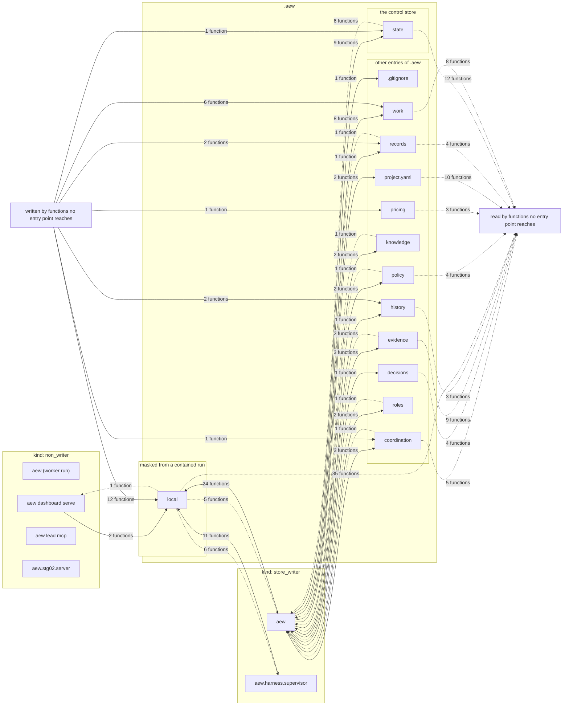

# Data flow

Which process writes or reads which entry of `.aew`, drawn from the records alone. Generated by `python tools/reference.py render`; do not edit. A process is an entry point ([entry-points.md](entry-points.md)), grouped by its kind: a **store_writer** takes the control lock and a **non_writer** reads lock-free. An entry is a top-level one of the layout ([layout.md](layout.md)). A solid arrow is a write and a dashed one a read, labelled with the number of distinct functions that do it. A write is a `writers` record's (entry point, entry) pair ([writers.md](writers.md)). A read is a function the `layout` records name as a reader of the entry that another record also reaches from entry points, a writer item or a lock-free member of the `concurrency` family ([concurrency.md](concurrency.md)); every other reader is drawn once, into the box "read by functions no entry point reaches". The group "masked from a contained run" is the layout's `masked_by_containment`, the one trust boundary the records state.

## Processes

| Entry point | Kind | Why |
|---|---|---|
| `aew` | store_writer | the CLI the operator, the Lead and AEW's own workers (the custody worker) run: engine commands take the control lock |
| `aew (worker run)` | non_writer | the CLI inside a worker's harness run (AEW_AGENT_ENDPOINT set): `whoami`, `check run` and `submit` go through the run's bridge, whose supervisor holds the credential and the lock; nothing else in that process may take the lock |
| `aew dashboard serve` | non_writer | the dashboard server, long-running and read-only: it reads the store lock-free (dashboard.reader) and serializes its own publication with its endpoint lock, never the control lock |
| `aew lead mcp` | non_writer | the Lead's MCP transport: it constructs no engine and forwards every call to the Lead broker, which holds the credential |
| `aew.harness.supervisor` | store_writer | a run's supervisor: holds the run's credential and commits through the engine |
| `aew.stg02.server` | non_writer | the STG-02 slice's producer: it reads a project's committed state lock-free (dashboard.reader) and writes only its own state directory, never the store |

## Entries of `.aew`

| Entry | Group | Written by | Read by | Written by no entry point | Read by no entry point |
|---|---|---|---|---|---|
| `.gitignore` | other entries of .aew | `aew` (1) | - | 0 | 0 |
| `coordination` | other entries of .aew | `aew` (3) | `aew` (1) | 1 | 5 |
| `decisions` | other entries of .aew | `aew` (1) | - | 0 | 4 |
| `evidence` | other entries of .aew | `aew` (3) | `aew` (2) | 0 | 9 |
| `history` | other entries of .aew | `aew` (1) | - | 2 | 3 |
| `knowledge` | other entries of .aew | `aew` (2) | `aew` (1) | 0 | 0 |
| `local` | masked from a contained run | `aew` (24), `aew dashboard serve` (2), `aew.harness.supervisor` (11) | `aew` (5), `aew dashboard serve` (1), `aew.harness.supervisor` (6) | 12 | 35 |
| `policy` | other entries of .aew | `aew` (2) | `aew` (1) | 0 | 4 |
| `pricing` | other entries of .aew | - | - | 1 | 3 |
| `project.yaml` | other entries of .aew | `aew` (2) | - | 0 | 10 |
| `records` | other entries of .aew | `aew` (1) | `aew` (1) | 2 | 4 |
| `roles` | other entries of .aew | `aew` (2) | `aew` (1) | 0 | 0 |
| `state` | the control store | `aew` (9) | `aew` (6) | 1 | 12 |
| `work` | other entries of .aew | `aew` (8) | - | 6 | 8 |

## Not drawn

- Writes by functions the call graph attributes to no entry point: 25 (entry, function) pairs, drawn from the box "written by functions no entry point reaches".
- Reads by functions no record reaches from an entry point: 97 (entry, function) pairs, drawn into the box "read by functions no entry point reaches"; each is in the layout page with its function.
- 39 write sites outside `.aew` and 24 write sites this reading could not place belong to no entry of the map (the writers page lists them).
- The bridge and the network. No record attributes a bridge call, or a route served, to the process that makes or serves it; the routes and tools are in [interfaces.md](interfaces.md), and what each process is stands in its reason above. Which entry points run contained is not a fact of the records either.
