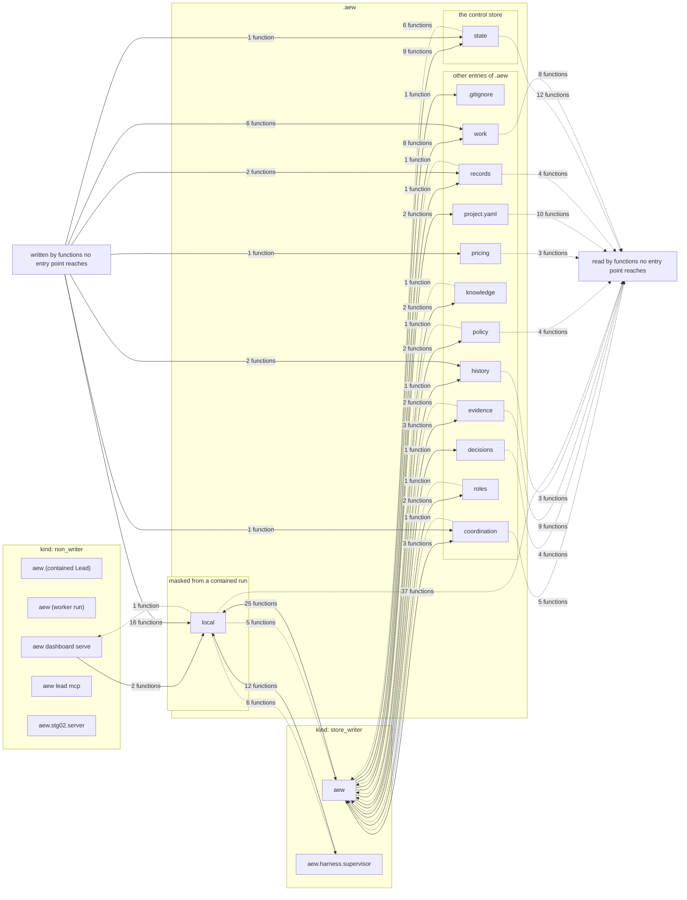

# Data flow

Which process writes or reads which entry of `.aew`, drawn from the records alone. Generated by `python tools/reference.py render`; do not edit. A process is an entry point ([entry-points.md](entry-points.md)), grouped by its kind: a **store_writer** takes the control lock and a **non_writer** reads lock-free. An entry is a top-level one of the layout ([layout.md](layout.md)). A solid arrow is a write and a dashed one a read, labelled with the number of distinct functions that do it. A write is a `writers` record's (entry point, entry) pair ([writers.md](writers.md)). A read is a function the `layout` records name as a reader of the entry that another record also reaches from entry points, a writer item or a lock-free member of the `concurrency` family ([concurrency.md](concurrency.md)); every other reader is drawn once, into the box "read by functions no entry point reaches". The group "masked from a contained run" is the layout's `masked_by_containment`, the one trust boundary the records state. **Every edge is a lower bound**, and a process or an entry with no edge is not shown to do nothing: see [Not drawn](#not-drawn).

## Processes

| Entry point | Kind | Why |
|---|---|---|
| `aew` | store_writer | the CLI the operator, the Lead and AEW's own workers (the custody worker) run: engine commands take the control lock |
| `aew (contained Lead)` | non_writer | the CLI inside the contained Lead's sandbox (AEW_LEAD_CONTAINED set): its Lead-authenticated commands go through the Lead broker, which holds the credential and the lock, and it reads lock-free, since the sandbox holds no control lock (`.aew/local` is masked) and `.aew` is read-only there; and the reads that broker relays to the host for it (lead_broker.RELAYED_READS), which read lock-free there too and write nothing |
| `aew (worker run)` | non_writer | the CLI inside a worker's harness run (AEW_AGENT_ENDPOINT set): `whoami`, `check run` and `submit` go through the run's bridge, whose supervisor holds the credential and the lock; nothing else in that process may take the lock |
| `aew dashboard serve` | non_writer | the dashboard server, long-running and read-only: it reads the store lock-free (dashboard.reader) and serializes its own publication with its endpoint lock, never the control lock |
| `aew lead mcp` | non_writer | the Lead's MCP transport: it constructs no engine and forwards every call to the Lead broker, which holds the credential |
| `aew.harness.supervisor` | store_writer | a run's supervisor: holds the run's credential and commits through the engine |
| `aew.stg02.server` | non_writer | the STG-02 slice's producer: it reads a project's committed state lock-free (dashboard.reader) and writes only its own state directory, never the store |

## Entries of `.aew`

| Entry | Group | Written by | Read by | Written by no entry point | Read by no entry point |
|---|---|---|---|---|---|
| `.gitignore` | other entries of .aew | `aew` (1) | - | 0 | 0 |
| `coordination` | other entries of .aew | `aew` (3) | `aew` (1) | 1 | 5 |
| `decisions` | other entries of .aew | `aew` (1) | - | 0 | 4 |
| `evidence` | other entries of .aew | `aew` (3) | `aew` (2) | 0 | 9 |
| `history` | other entries of .aew | `aew` (1) | - | 2 | 3 |
| `knowledge` | other entries of .aew | `aew` (2) | `aew` (1) | 0 | 0 |
| `local` | masked from a contained run | `aew` (25), `aew dashboard serve` (2), `aew.harness.supervisor` (12) | `aew` (5), `aew dashboard serve` (1), `aew.harness.supervisor` (6) | 16 | 37 |
| `policy` | other entries of .aew | `aew` (2) | `aew` (1) | 0 | 4 |
| `pricing` | other entries of .aew | - | - | 1 | 3 |
| `project.yaml` | other entries of .aew | `aew` (2) | - | 0 | 10 |
| `records` | other entries of .aew | `aew` (1) | `aew` (1) | 2 | 4 |
| `roles` | other entries of .aew | `aew` (2) | `aew` (1) | 0 | 0 |
| `state` | the control store | `aew` (9) | `aew` (6) | 1 | 12 |
| `work` | other entries of .aew | `aew` (8) | - | 6 | 8 |

## Not drawn

**Every edge is a lower bound.** The edges are drawn from 248 records (coverage: 248 lower-bound). The lists they give (the writers of an entry, its readers, the entry points that reach a function) are what the reading found, and each record says what it could not resolve. Those items follow, as the records give them, with the number of records that carry each; any of them may be an edge the map does not draw.

### Writes

The `writers` fact of the `writers` records.

- `aew`: write sites whose destination this reading could not place under `.aew` are records of the writers family keyed `writers:unresolved:<module>:<symbol>:<primitive>`; any of them may write this path (167 records)
- `aew.process_kind:require_writer`: the role `aew (worker run)` is chosen by an environment variable and not by a command, so the call graph attributes no handler to it, and its absence from `entry_points` says nothing; a write a non-writer process may not make is refused by `process_kind.require_writer` (at the control lock, and before an operation whose purpose is such a write), tested at run time by `test_no_command_a_worker_can_run_writes_under_aew_or_takes_the_lock` and not proved here (117 records)
- `aew.history.store:prewrite`: no static call chain from any entry point's declaring function reaches this writer (6 records)
- `aew.engine.store:ControlStore._commit_unprofiled`: no static call chain from any entry point's declaring function reaches this writer (4 records)
- `aew.harness.notify:DeliveryLog.record`: no static call chain from any entry point's declaring function reaches this writer (3 records)
- `aew.engine.coordination_ops:Coordination._write`: no static call chain from any entry point's declaring function reaches this writer (2 records)
- `aew.engine.custody_ops:spawn_worker`: no static call chain from any entry point's declaring function reaches this writer (2 records)
- `aew.engine.disposition_ops:Dispositions._write`: no static call chain from any entry point's declaring function reaches this writer (2 records)
- `aew.engine.queue_ops:Queue._checkout_sync_lock`: no static call chain from any entry point's declaring function reaches this writer (2 records)
- `aew.engine.stage_intents:StageIntents._end`: no static call chain from any entry point's declaring function reaches this writer (2 records)
- `aew.engine.usage_ops:write_pricing_snapshot`: no static call chain from any entry point's declaring function reaches this writer (2 records)
- `aew.harness.broker_liveness:write`: no static call chain from any entry point's declaring function reaches this writer (2 records)
- `aew.harness.event_spool:Reader.retire`: no static call chain from any entry point's declaring function reaches this writer (2 records)
- `aew.harness.notify:Watcher._write_state`: no static call chain from any entry point's declaring function reaches this writer (2 records)
- `aew.harness.opencode.lead:ContainedLead._seed_models`: no static call chain from any entry point's declaring function reaches this writer (2 records)
- `aew.harness.runlog:_open_append`: no static call chain from any entry point's declaring function reaches this writer (2 records)
- `aew.harness.steering_loop:_write`: no static call chain from any entry point's declaring function reaches this writer (2 records)
- `aew.harness.tool_calls:append`: no static call chain from any entry point's declaring function reaches this writer (2 records)
- `aew.history.store:History.append`: no static call chain from any entry point's declaring function reaches this writer (2 records)
- `aew.engine.context_ops:ContextPacks.build_pack`: no static call chain from any entry point's declaring function reaches this writer (1 record)
- `aew.engine.coordination_ops:Coordination._ensure_marker`: no static call chain from any entry point's declaring function reaches this writer (1 record)
- `aew.engine.disposition_ops:_unlink`: no static call chain from any entry point's declaring function reaches this writer (1 record)
- `aew.engine.integration_ops:Integration._finish_publish`: no static call chain from any entry point's declaring function reaches this writer (1 record)
- `aew.engine.work_ops:WorkUnits.propose`: no static call chain from any entry point's declaring function reaches this writer (1 record)
- `aew.harness.opencode.lead:ContainedLead.__call__`: no static call chain from any entry point's declaring function reaches this writer (1 record)
- `aew.harness.opencode.lead:ContainedLead._record`: no static call chain from any entry point's declaring function reaches this writer (1 record)
- `aew.harness.opencode.lead:ContainedLead._seed_logins`: no static call chain from any entry point's declaring function reaches this writer (1 record)
- `aew.harness.tool_calls:_rotate`: no static call chain from any entry point's declaring function reaches this writer (1 record)

### Readers of an entry

The `readers` fact of the `layout` records.

- `aew`: read sites whose path this reading could not place under `.aew` (a path from a parameter, the command line or the environment) are listed on the page and are not records; any of them may read this entry (71 records)

### Entry points of a lock-free member

The `entry_points` fact of the `concurrency` records.

- `aew.process_kind`: a function that works without the control lock and is neither named by `aew.process_kind` nor declared by this family is not listed; a call the call graph does not resolve is not followed (10 records)

### Not drawn by entry point

- Writes by functions the call graph attributes to no entry point: 29 (entry, function) pairs, drawn only from the box "written by functions no entry point reaches".
- Reads by functions no record reaches from an entry point: 99 (entry, function) pairs, drawn only into the box "read by functions no entry point reaches"; each is in the layout page with its function.
- 42 write sites outside `.aew` and 43 write sites this reading could not place belong to no entry of the map (the writers page lists them).
- The bridge and the network. No record attributes a bridge call, or a route served, to the process that makes or serves it; the routes and tools are in [interfaces.md](interfaces.md), and what each process is stands in its reason above. Which entry points run contained is not a fact of the records either.
