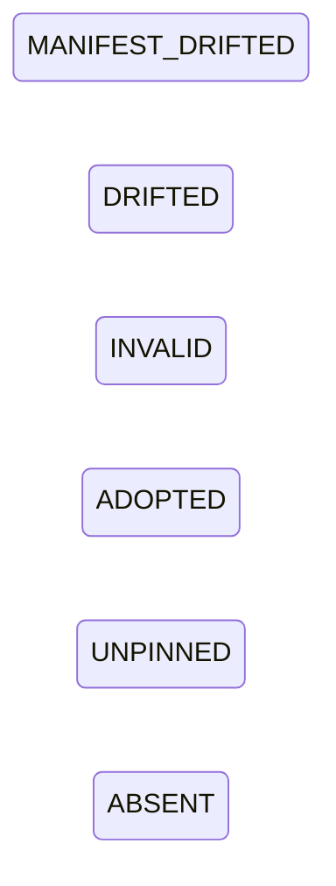
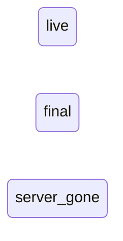

# State transition maps

One diagram per state machine of the code, drawn from the records alone. Generated by `python tools/reference.py render`; do not edit. An edge of the Ticket machine is labelled with the operation that takes it (and the others the code names for it), then `[guard]` when the edge has one, then `(reason)` when the operation must be given a reason. A state with a closing arrow is terminal. The tables, the guards and which edges code that does not ask the table can take are in [state-machines.md](state-machines.md); a second state set no table lists is in [gaps.md](gaps.md).

## Ticket

17 states, 94 edges: 29 complete-by-construction, 65 lower-bound.

```mermaid
stateDiagram-v2
    direction LR
    state "BLOCKED" as st_blocked
    state "READY" as st_ready
    state "ASSIGNED" as st_assigned
    state "RUNNING" as st_running
    state "REVIEW_FAILED" as st_review_failed
    state "REVIEW_PENDING" as st_review_pending
    state "REVIEW_PASSED" as st_review_passed
    state "VERIFICATION_FAILED" as st_verification_failed
    state "VERIFICATION_INCONCLUSIVE" as st_verification_inconclusive
    state "VERIFY_PENDING" as st_verify_pending
    state "VERIFIED" as st_verified
    state "COMMIT_READY" as st_commit_ready
    state "DONE" as st_done
    state "CANCELLED" as st_cancelled
    state "ESCALATED" as st_escalated
    state "INTERRUPTED" as st_interrupted
    state "REPLAN_REQUIRED" as st_replan_required
    st_done --> [*]
    st_cancelled --> [*]
    st_assigned --> st_cancelled : transition (reason)
    st_assigned --> st_escalated : transition (reason)
    st_assigned --> st_interrupted : interrupt
    st_assigned --> st_replan_required : transition (reason)
    st_assigned --> st_running : transition [implementer_active]
    st_blocked --> st_cancelled : transition (reason)
    st_blocked --> st_ready : recompute
    st_blocked --> st_replan_required : transition (reason)
    st_commit_ready --> st_cancelled : transition (reason)
    st_commit_ready --> st_done : integrate.publish
    st_commit_ready --> st_escalated : transition (reason)
    st_commit_ready --> st_interrupted : interrupt
    st_commit_ready --> st_replan_required : transition (reason)
    st_commit_ready --> st_running : transition (reason)
    st_commit_ready --> st_verification_failed : verify.ingest / integrate.validate
    st_escalated --> st_cancelled : transition (reason)
    st_escalated --> st_interrupted : interrupt
    st_escalated --> st_replan_required : transition (reason)
    st_escalated --> st_review_pending : transition [returning_from_escalation] (reason)
    st_escalated --> st_running : transition [returning_from_escalation] (reason)
    st_escalated --> st_verify_pending : transition [returning_from_escalation] (reason)
    st_interrupted --> st_assigned : reconcile [not_beyond_interrupted_phase] (reason)
    st_interrupted --> st_cancelled : transition (reason)
    st_interrupted --> st_commit_ready : reconcile [not_beyond_interrupted_phase] (reason)
    st_interrupted --> st_escalated : transition (reason)
    st_interrupted --> st_replan_required : transition (reason)
    st_interrupted --> st_review_passed : reconcile [not_beyond_interrupted_phase] (reason)
    st_interrupted --> st_review_pending : reconcile [not_beyond_interrupted_phase] (reason)
    st_interrupted --> st_running : reconcile [not_beyond_interrupted_phase] (reason)
    st_interrupted --> st_verified : reconcile [not_beyond_interrupted_phase] (reason)
    st_interrupted --> st_verify_pending : reconcile [not_beyond_interrupted_phase] (reason)
    st_ready --> st_assigned : assign
    st_ready --> st_blocked : recompute
    st_ready --> st_cancelled : transition (reason)
    st_ready --> st_replan_required : transition (reason)
    st_replan_required --> st_blocked : plan.accept
    st_replan_required --> st_cancelled : transition (reason)
    st_replan_required --> st_escalated : transition (reason)
    st_replan_required --> st_interrupted : interrupt
    st_replan_required --> st_ready : plan.accept
    st_review_failed --> st_cancelled : transition (reason)
    st_review_failed --> st_escalated : transition (reason)
    st_review_failed --> st_interrupted : interrupt
    st_review_failed --> st_replan_required : transition (reason)
    st_review_failed --> st_running : transition [findings_recorded]
    st_review_passed --> st_cancelled : transition (reason)
    st_review_passed --> st_commit_ready : transition [commit_ready_without_verification]
    st_review_passed --> st_done : accept [evidence_only_complete]
    st_review_passed --> st_escalated : transition (reason)
    st_review_passed --> st_interrupted : interrupt
    st_review_passed --> st_replan_required : transition (reason)
    st_review_passed --> st_running : transition (reason)
    st_review_passed --> st_verify_pending : transition [review_current]
    st_review_pending --> st_cancelled : transition (reason)
    st_review_pending --> st_escalated : transition (reason)
    st_review_pending --> st_interrupted : interrupt
    st_review_pending --> st_replan_required : transition (reason)
    st_review_pending --> st_review_failed : review.ingest
    st_review_pending --> st_review_passed : review.ingest
    st_review_pending --> st_running : transition (reason)
    st_running --> st_cancelled : transition (reason)
    st_running --> st_commit_ready : transition [commit_ready_without_review_or_verification]
    st_running --> st_done : accept [evidence_only_complete]
    st_running --> st_escalated : transition (reason)
    st_running --> st_interrupted : interrupt
    st_running --> st_replan_required : transition (reason)
    st_running --> st_review_pending : transition [ready_for_review]
    st_running --> st_verify_pending : transition [ready_for_verification_without_review]
    st_verification_failed --> st_cancelled : transition (reason)
    st_verification_failed --> st_interrupted : interrupt
    st_verification_failed --> st_replan_required : verify.classify
    st_verification_failed --> st_running : verify.classify
    st_verification_failed --> st_verification_inconclusive : verify.classify
    st_verification_inconclusive --> st_cancelled : transition (reason)
    st_verification_inconclusive --> st_escalated : transition (reason)
    st_verification_inconclusive --> st_interrupted : interrupt
    st_verification_inconclusive --> st_replan_required : transition (reason)
    st_verification_inconclusive --> st_running : transition (reason)
    st_verification_inconclusive --> st_verify_pending : transition (reason)
    st_verified --> st_cancelled : transition (reason)
    st_verified --> st_commit_ready : transition [all_gates_current]
    st_verified --> st_done : accept [evidence_only_complete]
    st_verified --> st_escalated : transition (reason)
    st_verified --> st_interrupted : interrupt
    st_verified --> st_replan_required : transition (reason)
    st_verified --> st_running : transition (reason)
    st_verify_pending --> st_cancelled : transition (reason)
    st_verify_pending --> st_escalated : transition (reason)
    st_verify_pending --> st_interrupted : interrupt
    st_verify_pending --> st_replan_required : transition (reason)
    st_verify_pending --> st_running : transition (reason)
    st_verify_pending --> st_verification_failed : verify.ingest
    st_verify_pending --> st_verification_inconclusive : verify.ingest
    st_verify_pending --> st_verified : verify.ingest
```

## Configuration document

6 states, in the order the code lists them. The records say "no edge table: how a state follows another is not recorded in a table, so no exit is enumerated", so no edge is drawn.

## Live usage

3 states, in the order the code lists them. The records say "no edge table: how a state follows another is not recorded in a table, so no exit is enumerated", so no edge is drawn.

