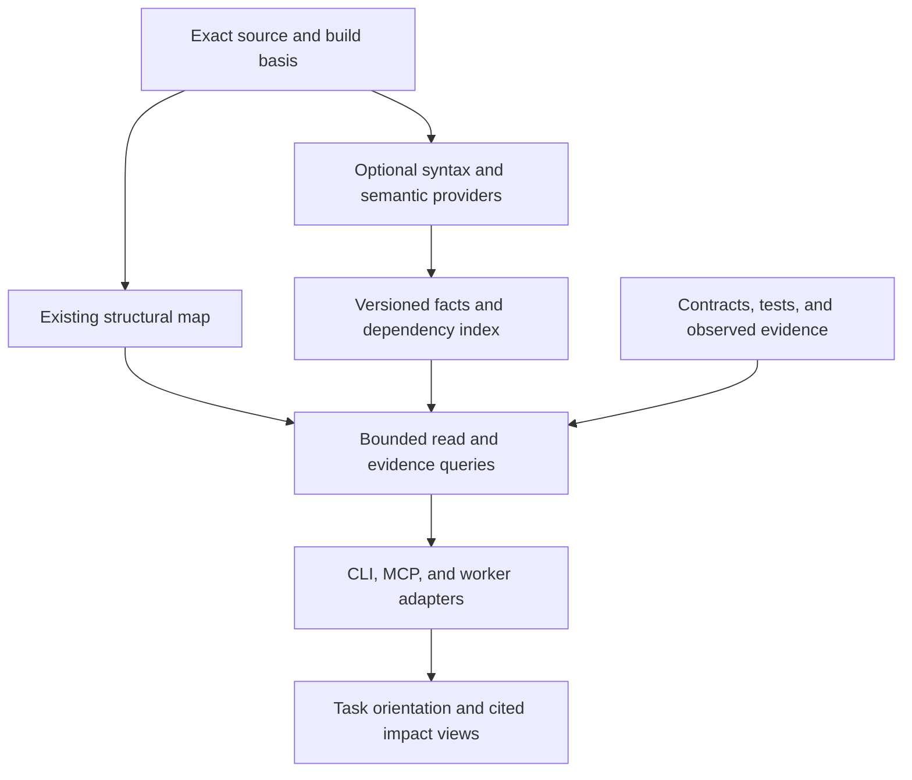

# AEW Codebase Mapping: Audit and Implementation Plan

*Provenance: filed on 2026-11-25 from the operator's upload of this audit (v0.1); one private project name was replaced with a generic description (§8, Phase 5). Otherwise unchanged.*

**Prepared for:** AEW technical lead and operator  
**Date:** November 24, 2026  
**Status:** Review and implementation proposal; this document does not adopt a new capability profile or change the work register.  
**Repository:** JonSmithTLT/Agentic-Engineering-Workflow  
**Audited commit:** 308410194b2891bdf1c838255db530f6da581d4b  
**Git tree:** b428ff6002dc89777d87c8f5510ecd8ea4c30020

## 1. Recommendation

**Preserve the current structural map, complete its current-profile qualification, and build a bounded code-navigation interface that can serve both structural information and optional semantic providers.** Use C/C++ as the first semantic candidate, consistent with the existing research, then qualify the actual supported profile on real work.

AEW has considerably more than a file tree. It has a deterministic structural generator, recorded inputs, content-addressed artifacts, a separate selection revision, freshness checks, bounded worker context, and refresh at use. These are useful foundations. The shipped mapping package does not yet extract source ASTs, index definitions and references, resolve calls, or answer semantic relationship queries. Its semantic-prerequisites section detects configuration hints; it does not establish semantic capability. [S01] [S02] [S03] [S04]

The missing product is not an AST dump. It is an agent-facing navigation system that answers a sequence of practical questions:

1. Where does this behavior enter the system?
2. Which definitions and references are relevant?
3. How does control pass between them under this build configuration?
4. Which tests, contracts, configuration, and consumers could be affected?
5. What evidence supports the answer, and what could not be established?

An AST is one source of facts for that system. Resolved symbols, cross-file relationships, configuration identity, evidence, and an efficient query interface are also needed. Architecture and intent require an additional synthesis layer grounded in code and governing documents.

The recommended order is:

- Finish E293's qualification of the structural behavior already serving agents.
- Improve scoped retrieval and expose existing information through the planned typed read surface.
- Benchmark one C/C++ semantic candidate under CAPR-B2.
- Implement the selected semantic profile incrementally behind that same read interface.
- Add advisory test/constraint locators, impact assistance, and evidence-backed architecture synthesis under their existing work owners.

This ordering uses existing investments and respects the current selected profile. It does not make a semantic graph a prerequisite for ordinary AEW work. [S14] [S15] [S16]

## 2. Scope and evidence limits

This is a mapping capability and architecture audit, not a whole-repository security assessment, a merge review, or a certification that every P-01 obligation is met.

The audit used the complete, non-truncated Git path inventory at the pinned commit and a selected source snapshot covering the entire shipped maps package, schemas, CLI, MCP catalog, worker and Lead read paths, context assembly, dashboard projection, relevant tests, contracts, work-register entries, and research. Selected source bytes were checked against Git blob identities.

The audit distinguishes:

- **Implemented:** directly supported by source at the pinned commit.
- **Tested in repository:** relevant test cases were inspected, but the suite was not rerun.
- **Reproduced here:** one focused directory-cap probe was executed against the actual generator helper.
- **Designed or scheduled:** supported by adopted records or the current register, without claiming implementation.
- **Recommended:** a proposal in this report.

No production code, tests, repository configuration, work-register entries, or pull requests were changed. The full AEW test suite, a live harness session, and production semantic extraction were not run.

## 3. What exists now

### 3.1 Implementation map

| Area | Current implementation | Assessment |
| --- | --- | --- |
| Canonical representation | src/aew/maps/canonical.py | Canonical serialization, escaped names, path-listing identity, artifact digest. |
| Git source reader | src/aew/maps/gitobjects.py | Reads exact commit objects with tracked metadata reads; does not use a dirty checkout as the commit's contents. |
| Structural facts | src/aew/maps/structural.py and rules.yaml | Directory/language inventory and bounded descriptor/convention extraction. No source-code parser. |
| Storage and selection | src/aew/maps/store.py | Immutable artifacts, schema/digest checks, registry selection with its own epoch/revision. |
| Freshness | src/aew/maps/freshness.py | Compares generator, tree/path membership, and actual recorded metadata inputs. |
| Lifecycle | src/aew/maps/service.py | Generate/show/diff, first map at init, architecture-reference selection, refresh at dispatch. |
| Worker delivery | src/aew/maps/slices.py; engine/context_ops.py; knowledge/context.py | Pins a scoped slice and its basis; budgets it below mandatory context. |
| Human and Lead reads | src/aew/cli/map_commands.py; harness/lead_broker.py | CLI reads are available; the contained Lead has a brokered route. |
| Normal agent tools | src/aew/surface/contract.py; surface/mcp.py; harness/bridge.py | No first-class map or semantic query in the normal MCP catalog or worker bridge. |
| Dashboard | src/aew/dashboard/mapview.py | Bounded projections and comparisons of existing map fields; no semantic extraction. |
| Investigation method | skills/shipped/codebase-investigation/SKILL.md | Useful investigation guidance; optional and labeled unevaluated in the shipped skill manifest. |

Sources: [S01]–[S13], [S22], [S23], [S30], [S31].

### 3.2 Structural information is richer than paths

The current record contains eight sections:

| Section | What it establishes | What it does not establish |
| --- | --- | --- |
| Directories | File counts, depth-limited ancestry, extension-derived language labels, conventional directory labels. | Component responsibility or runtime relationships. |
| Languages | Exact-name/extension classifications. | Parsed syntax, type correctness, or supported semantic coverage. |
| Build descriptors | Located build/manifests and limited parsed declarations. | A complete build or package dependency graph. |
| Entry-point candidates | Declared scripts, package entry fields, Cargo binaries, and conventions. | A proven end-to-end execution path. |
| Test candidates | Test directories, filename patterns, runner configuration. | Which behavior a test exercises or whether it passed. |
| Generated/vendor hints | Conventions and positive attribute hints. | Authoritative policy or a reliable ownership boundary. |
| Semantic prerequisites | Names such as compile_commands.json, .clangd, tsconfig.json, and related hints. | A working AST, resolver, semantic index, or call graph. |
| Limits and omissions | Caps, unsupported inputs, parse failures, and related coverage information. | Proof that unreported project elements do not exist. |

Only the descriptor parsers for pyproject, Cargo, package.json, and setup.cfg are registered in the structural generator. Python AST use in the generator's tests checks the generator's own I/O boundary; it is not a product AST capability. [S01] [S02] [S24]

### 3.3 Maps already reach workers

New projects initialize with structural map slices enabled. An absent setting in an older project remains off for compatibility. All worker archetypes have a map context slot; the inspected integration cases cover normal implementation, review, verification, investigation, research, and planning delivery. This is already shipped behavior. [S04] [S17] [S25]

At dispatch, AEW can refresh a missing or stale map against the work's base. A map for the authoritative head can become selected; a historical work-base map can be pinned without moving the project-wide selection backward. Failed refreshes are remembered for the same base and generator so an expensive identical failure is not repeated on every dispatch. [S03] [S26]

The worker slice is deliberately small: directory rows and generated/vendor hints, with freshness and omission information. The code specifies 40 directory rows, 20 hints, and a nominal 9 KiB body budget. Fixed explanatory/freshness lines can exceed that nominal budget in an exceptional case, so it should not be advertised as an unconditional hard byte ceiling. [S04]

The pack pins the artifact identity, source basis, freshness, and rendered slice. Later selection changes or artifact loss do not silently rewrite the worker's historical context. Mandatory work and governing context have higher budget priority than the map. These properties should carry forward into semantic result delivery. [S04] [S11] [S25]

### 3.4 Current access has an important asymmetry

The CLI provides map show, section reads, stored-root reads, and structural diff. The contained Lead can call show/diff through its host broker. It would be incorrect to say the Lead has no map access. [S06] [S07]

However:

- The normal Lead MCP catalog has no map-query operation.
- The MCP server is tied to a live Lead session, so adding tools there alone would not create an arbitrary-agent endpoint.
- The worker bridge exposes identity, checks, submission, and optional messaging, but no follow-up map query.
- Workers receive a fixed slice and can investigate source, but cannot ask a dedicated map tool for the next relevant section.
- The CLI does not offer symbol, caller, reference, dependency, or task-scoped path queries. [S08] [S09] [S10]

One naming detail matters for future API design: map show with a commit compares the selected map's freshness against that commit. It does not generate and return a map of that commit. New interfaces should distinguish requested source snapshot, selected artifact, and freshness-comparison basis explicitly. [S03]

## 4. AST, semantics, and understanding are different layers

| Layer | Representative question | Necessary facts |
| --- | --- | --- |
| Structural | Where are native sources and test directories? | Tracked paths, descriptors, conventions. |
| Syntax | Which functions, types, imports, and call expressions occur here? | Parsed source trees and exact source spans. |
| Resolved semantics | Which declaration does this use bind to under this configuration? | Symbol identity, resolver/compiler context, definitions, references, typed relationships. |
| Architecture | Why is this boundary present, and how does the feature work across components? | Semantic facts plus contracts, design decisions, registration/configuration, and cited synthesis. |
| Change assistance | What could be affected by this edit, and what should I inspect or test? | A bounded dependency neighborhood, test/constraint locators, uncertainty, and verification. |

Tree-sitter is useful for fast, incremental syntax extraction and incomplete files. Its documented product is a concrete syntax tree. Adopting it does not by itself supply project-wide name binding or prove that a syntactic call expression invokes a particular target. [E01]

For example, a parser can recognize:

    device->ops->send(device, packet);

A useful semantic response must distinguish the call site, the member being selected, the function-pointer type, candidate assignments or implementations, and unresolved runtime selection. Reporting a single unconditional calls edge would exceed the observation.

C/C++ adds preprocessing and build identity. The same source may mean something different with a different target, macro definition, include order, generated header, or compiler installation. Compilation databases permit multiple commands for one source file; the command and working directory are part of the parsing basis. [E02] [E03]

Even a correctly resolved direct call does not establish the deployed program's full runtime behavior. Reflection, plugins, FFI, dynamically selected implementations, linker choices, and external systems can require other evidence. The goal should be **reliable, evidence-backed understanding within a declared domain**, with unsupported questions exposed clearly.

## 5. Existing design work and current authority

### 5.1 The roadmap is not a blank slate

Historical T5 v0.5 already describes a language-neutral structural base, additive semantic extensions, typed queries, per-unit freshness, source symbols and emitted instances, bounded context, and an architecture bridge. The C/C++ research includes measured C work and a later C++ representation probe. [S18] [S19] [S20] [S21]

The later C++ probe found a real toolchain mismatch: libclang and the compiler selected different standard-library installations. Aligning the toolchain substantially improved include agreement, while retaining explicit residual differences. It also found that a cursor-only interface misses implicit C++ instances and generated members. The later design therefore specifies a composite extractor identity with AST and code-generation components where those observations are claimed. [S18] [S20]

These are completed research findings, not proof that the production provider exists. Conversely, the older statement that C++ had not yet been probed is obsolete. The next work is implementation and qualification against supported claims, not another broad representation study.

### 5.2 Current scheduling and evidence limits must be preserved

A-14/P-01 is an adopted current source despite retained candidate/proposal wording inside its original bytes. The generated contracts index and adoption wrapper establish its current status. Later work-register dispositions control how older T5 mechanics apply. [S14] [S27]

| Existing owner | Current disposition | Implication for this plan |
| --- | --- | --- |
| F22.1 | Structural core built and closed. | Extend and qualify it; do not restart it. |
| E184 / E62 | Worker map serving, refresh at use, new-project defaults. | Preserve current delivery; do not list all-card enablement as missing. |
| E293 | Current V-01 structural profile and qualification. | Immediate qualification work against the built system. |
| F15.8 | Typed worker map-read transport/envelope. | Own the shared read interface and bounded result contract here. |
| F22.2 | Semantic substrate/extension, on measured need. | Qualify value through CAPR-B2 and select P-DEC-03 profile. |
| F22.3 | Test/constraint indexes, unscheduled. | Supply advisory locators; do not make them new mandatory tests. |
| F30 | Impact assistance. | Keep change-impact conclusions under the established owner. |
| F22 | Architecture synthesis/composed view, unscheduled. | Build after usable facts and evidence access, when scheduled. |

The current selected custody posture is AGENT_REACHABLE_DERIVED. There is no new protected map writer or custody service in this scope, and a selected local map does not become a qualified shared authoritative result. A digest and generator name establish useful identity claims; they do not authenticate the producer or elevate the artifact's evidence class. [S14] [S15]

C/C++ is the strongest first semantic candidate from the existing research. The currently selected language/configuration profile still needs its P-DEC-03 decision. CAPR-B2 asks for correct task completion per cost on the operator's work; a provider health check alone is not qualification. [S15] [S16]

## 6. Audit findings and consequences

### Finding 1 — Source relationships are the central missing capability

**Status:** Confirmed capability gap.

The shipped schema has structural sections and no source symbols, definitions, references, call edges, or source spans. The registry supports structural maps and architecture evidence references. A semantic-prerequisites card cannot answer who calls a function or which implementation a reference denotes. [S01] [S02] [S05]

**Consequence:** Agents still pay much of the cross-file investigation cost themselves.

**Recommendation:** Add a separate versioned semantic fact model. Do not overload the structural schema or relabel its hints as semantics.

### Finding 2 — The query path is not yet available to every intended agent

**Status:** Confirmed usability/integration gap.

Full-map CLI reads exist for the Lead, but the normal MCP catalog and worker bridge do not expose a dedicated map query. Default worker slices omit entry points, build descriptors, test candidates, and semantic prerequisites even though the full map already has them. [S04] [S06]–[S10]

**Consequence:** Useful current information can be inaccessible through the agent's normal tool-discovery path, and the fixed slice cannot support progressive investigation.

**Recommendation:** Implement the planned bounded read interface with CLI parity and invocation-bound worker access. Keep generation and registry selection separate from read access. Agents outside an AEW workflow should be able to use repository-local, read-only navigation within their ordinary filesystem access, without impersonating a Lead.

### Finding 3 — Global truncation can remove the task's own directory

**Status:** Reproduced generator behavior; downstream slice consequence established by source review.

The generator sorts directories by file count and keeps 200 rows. Only afterward does the slice filter those retained rows by task scope. A relevant small directory can therefore disappear before scope selection. [S01] [S04]

Focused reproduction:

| Input or output | Result |
| --- | --- |
| Larger directories | 205, with two files each |
| Task directory | z_task, with one file |
| Total regular files | 411 |
| Directory rows including root | 207 |
| Rows retained | 200 |
| Rows omitted | 7 |
| Task file present in input | Yes |
| Task directory present in retained map | No |

The probe imported the actual Entry type, rules loader, and structural directory generator from the pinned source. Its assertions passed. It did not execute the slice renderer or the full test suite.

**Consequence:** The map honestly reports omissions but can still fail the most useful orientation request.

**Recommendation:** Query a complete derived path index or compute the requested subtree before applying the view budget. Preserve the compact global overview. A scoped artifact needs an explicit scope/schema identity; any changed canonical generation semantics need the corresponding generator-version change. Merely increasing 200 delays the problem.

### Finding 4 — Structural currentness cannot be reused for semantic facts

**Status:** Confirmed design boundary, not a defect in the current structural behavior.

Ordinary source-body edits can leave the structural map CURRENT when tracked paths and recorded descriptor inputs are unchanged. The listing hash deliberately excludes ordinary blob identities. This is correct for a map that does not read source bodies. [S12] [S24] [S28]

**Consequence:** Reusing that freshness label for symbols or calls would make stale semantic facts appear current.

**Recommendation:** Give each semantic unit its own source/configuration/dependency basis. Keep freshness, support, coverage, provenance class, and resolution status separate.

Track negative dependencies as well as positive ones. For example, with include order generated/ then include/, a new generated/config.h can change resolution even if the previously used include/config.h did not change. Missing or untracked resolution closure must reduce the claim, not silently preserve currentness. [S14]

### Finding 5 — Section bounds do not establish a global resource bound

**Status:** Confirmed implementation limit; no general resource-exhaustion benchmark was performed.

The current reader materializes the full path listing, and the input manifest records every considered metadata input, including skipped files. Bounded displayed sections and bounded metadata bytes do not make memory, artifact size, or runtime constant for arbitrary repositories. [S01] [S02] [S13]

The refresh deadline applies to several I/O and lock operations, but it does not preempt all Python parsing, sorting, serialization, and filesystem work. An overrun was not reproduced here. Likewise, the slice's fixed lines can exceed its nominal byte budget. [S03] [S04] [S13]

**Consequence:** Appending a whole semantic graph to one map JSON, or extracting it synchronously inside dispatch, would scale poorly.

**Recommendation:** Use immutable per-file/per-unit fact shards and a rebuildable index. Run expensive extraction separately with cancellation and resource limits. Dispatch should use available facts, report their state, and continue useful work.

### Finding 6 — Architecture and impact assistance remain separate unfinished capabilities

**Status:** Confirmed capability boundary and register disposition.

Selecting an architecture evidence reference does not synthesize a complete architecture map. Test candidates do not establish tests-to-behavior links. Structural diff does not establish change impact. [S03] [S15]

**Recommendation:** Compose evidence-backed views only after the query layer can retrieve precise facts. Keep extracted observations, investigator interpretation, accepted project decisions, and observed test/runtime evidence distinguishable. A map may suggest inspection or tests; it must not waive them.

### Finding 7 — Agent usefulness has not been established by the existing rehearsal

**Status:** Confirmed evaluation limit.

The shipped investigation skill is optional and labeled unevaluated. The repository now contains a context-pack rehearsal, but its README explicitly says scripted workers, zero model budget, and no model runs. Its scores establish delivery/grading behavior, not improved agent performance. [S22] [S23] [S29]

**Recommendation:** Reuse that instrumentation for a real, separately preregistered mapping evaluation. Measure discovery, correct navigation, supported conclusions, cost, and task outcomes.

## 7. Recommended target architecture

The following is a proposed extension, not a diagram of already shipped semantic functionality.

### 7.1 Store facts that support questions

Useful first entities are files, modules, symbols, definition/reference locations, and compilation units or equivalent configuration contexts.

Useful first relationships are contains, declares/defines, references, imports/includes, direct calls, and implements/overrides where the selected backend can support them. Keep indirect call sites and dependent expressions distinct from resolved direct edges. Add deeper data-flow analysis only for a demonstrated workload need.

Every relation should identify:

- Exact source basis and source locations.
- Relevant build/configuration and extractor identity.
- Observation type: syntax, resolved compiler observation, static inference, investigator interpretation, or observed execution.
- Resolution status and known alternatives.
- Coverage and omissions for the queried relation.
- The dependency basis needed for freshness.
- Evidence/custody class appropriate to its actual production and storage path.

A parser's technical observation does not upgrade AGENT_REACHABLE_DERIVED output to a stronger evidence class merely because a field says compiler_known.

Use backend symbol identities where possible, with explicit normalization and configuration rules. Preserve source-level entities separately from configuration-specific or emitted instances. Do not promise identity survives arbitrary renames or compiler changes without a defined mapping.

### 7.2 Use an index instead of a prompt-sized graph

A local relational index is a reasonable starting implementation, subject to measurement. Per-unit immutable facts can feed symbol, occurrence, edge, and dependency tables with indexes for bounded lookups. A graph database is not a prerequisite.

Cache keys must include the actual inputs relevant to the extractor, not just repository HEAD. Publish completed generations atomically; concurrent queries should see a coherent generation, not half of a rebuild. Treat dirty worktree or editor-buffer facts as a separately identified overlay over a base revision, never silently as facts about the committed snapshot.

The initial release can support committed snapshots only if it advertises that limit and falls back to source reads for newer edits. Any claim of understanding current edits requires an explicit overlay and invalidation policy.

### 7.3 Define a small portable read surface

Start from the planned F15.8/T5 query vocabulary below. These are planned capabilities, not claims about shipped commands; preserve frozen names such as map.search and extend the existing module rather than create a competing API. [S15]

| Operation | Agent purpose |
| --- | --- |
| map.search | Resolve exact locators first, then provide a bounded workspace-rooted lexical fallback; hits remain candidates. |
| map.symbol | Resolve an exact symbol/location without conflating duplicate names; expose supported definition/reference information. |
| map.callers / map.callees | Retrieve bounded supported relationships; answer NOT_SUPPORTED until a qualified extension covers them. |
| map.tests_for / map.constraints | Retrieve advisory test and governing-source locators as the corresponding indexes become available. |
| map.changed | Navigate the relevant source-change basis through the shared typed query contract. |
| evidence.show | Retrieve observed source locators and basis details for investigation. |
| check.suggest | Provide advisory check candidates under the owning capability's rules. |

Capability/status discovery and task orientation should make the available sections, languages, relation types, source basis, coverage, and update state explicit. Additional reference/include/override views can extend this module under the selected profile. Broader impact assistance remains F30's work.

F15.8 owns the transport/server/bridge and common result envelope. F22.2/T5-B owns the typed map-query semantics and the one shared query module, which can initially answer structural queries through F15.8 before semantic extraction is available. Later semantic support extends that same module. CLI, normal Lead tools, and worker tools should call the same core query functions. [S15]

A standalone read adapter should work in a plain Git repository with explicit repository and snapshot coordinates, without a Lead session or initialized AEW control store. The current CLI still obtains an engine through Engine.discover; removing only a token requirement would not achieve that independence. Any derived cache must follow the selected profile without adopting workflow state or modifying source. AEW invocation adapters must retain the assignment's basis and recipient restrictions. [S06] [S32]

An agent can translate a question such as “where are retries controlled?” into explicit scope, symbol and relation requests. Keep the public surface typed and bounded, consistent with the existing rejection of a broad free-text semantic facade. If embedding-based ranking is later selected inside scoped candidate retrieval, its matches remain locators to verify through evidence queries; they do not certify relationships. A vector database is not required for the initial tool. [S15]

A response needs the requested subject, actual source/configuration, capability/profile, evidence class, freshness, coverage, result status, items, omissions, and bounded continuation or next step. Do not turn the contract's semantic outcome categories into a new universal wire enum without the owning design work.

An empty list is insufficient. It could mean covered absence, unsupported relation, parse failure, incomplete indexing, incompatible configuration, scope exclusion, inaccessible information, or exhausted budget. The response must make the allowed distinction without leaking restricted information. [S14]

### 7.4 Provider selection

| Option | Useful role | Limit to respect |
| --- | --- | --- |
| Tree-sitter | Portable syntax fallback, outlines, source spans, lexical candidates. | Syntax alone does not resolve program meaning. |
| Clang/clangd | C/C++ AST and compiler-backed symbol/reference information under a compile context. | Adapter must expose supported relations, configuration and coverage honestly. |
| Purpose-built LibTooling exporter | Precise extraction where full AST access or additional instrumentation is needed. | More maintenance; qualify against the pinned toolchain and oracle. |
| SCIP importer | Reuse language-neutral symbol/reference indexes from supported providers. | Import format does not guarantee all desired call/impact facts or currentness metadata. |

Clang's own interface guidance distinguishes the stable, higher-level libclang interface from LibTooling's fuller AST access. clangd already has symbols, references, relations, and layered indexes; its background index handles information beyond the current open-file AST. These are useful foundations to evaluate before building equivalent compiler infrastructure. [E04] [E05]

SCIP provides a reusable navigation interchange format and lists C/C++, Python, TypeScript and other indexers. Treat it as an optional adapter, retaining AEW's missing configuration, provenance, coverage, or dependency metadata alongside imported records. [E06]

**Recommendation:** Compare a compiler-backed C/C++ provider against the existing research/oracle requirements. Choose the smallest implementation that meets the selected profile. If the first profile omits implicit template instances or indirect-call target resolution, say so. If it claims them, supply the additional observations the earlier C++ research showed were needed.

Do not make general-language syntax coverage a claim of equal semantic support in every language.

## 8. Implementation plan

Work packages below are proposed decomposition under existing owners. They are not newly adopted register rows or calendar commitments.

### Phase 1 — Qualify and improve the existing structural experience

**Owners:** E293 with the existing E184/E62 behavior.

**Deliverables**

- A concise current capability profile, including AGENT_REACHABLE_DERIVED status and committed-source limits.
- Explicit source/work/recipient basis at the relevant serving boundary.
- Truthful caps, omissions, unavailable-map fallback, and an actionable wider-investigation path.
- Scope-aware retrieval that can recover small/deep relevant directories without enlarging every prompt.
- Documentation that reflects current defaults and makes candidate/adoption chronology understandable.

**Acceptance**

- A new project receives structural slices; an old absent/off setting is preserved.
- The 207-row reproduction can retrieve z_task within its scoped result.
- Missing/corrupt/stale maps retain usable source navigation and truthful status.
- A historical ticket does not appear to be operating on another checkout's current map.
- A cap-induced omission is not reported as absence.

**Dependency:** None on a semantic provider. This should start first.

### Phase 2 — Deliver the typed read interface

**Owners:** F15.8 for transport and envelope, coordinated with F22.2/T5-B's one shared query module and semantics. Coordinate with the intended release schedule rather than silently accelerating it.

**Deliverables**

- Shared structural status/orientation/section query functions.
- CLI parity, first-class normal Lead discovery, and invocation-bound worker reads.
- Source-snapshot selection distinct from freshness comparison.
- Bounded responses with continuation or a concrete source fallback.
- The ability to retrieve existing entry-point, build and test hints on demand.

**Acceptance**

- An unfamiliar agent discovers the normal tool and retrieves the relevant section without operator coaching or a recovery command.
- Lead and worker requests for the same allowed basis agree on the underlying facts.
- A worker cannot change map selection through a read request.
- Query responses preserve scope, basis, omission information, and mandatory-context priority.
- A non-MCP agent can perform the same navigation through documented JSON CLI output.
- A caller can navigate a plain Git repository by explicit repository/snapshot identity without a Lead session or initialized AEW control store; derived-cache behavior does not adopt workflow state or modify source.

**Dependency:** Begin against the current structural model; do not wait for the semantic index.

### Phase 3 — Select and qualify one semantic candidate

**Owners:** CAPR-B2 and P-DEC-03, feeding F22.2.

**Deliverables**

- A narrow supported-language/build/relation profile.
- Provider comparison on actual operator tasks.
- Reused C/C++ cases from the earlier zlib/curl/fmt work, refreshed for the supported toolchain.
- Controlled extraction under the existing inspection/effect rules.

Repository compile metadata must be parsed as data. Use a qualified installed tool and allowed argv/working-directory/input roots; do not execute arbitrary command strings, repository compiler wrappers, or plugin-loading options as part of passive navigation. This is already part of P01-19, not a request for a new privileged map service. [S14]

**Acceptance**

- Compile commands, toolchain, source basis and generated-input availability are recorded.
- The same source under two materially different configurations produces distinguishable results.
- Unsupported units and unresolved calls remain explicit.
- Provider functioning is distinguished from demonstrated task value.
- Proceeding to a production profile follows the workload-value decision, not merely successful installation.

**Dependency:** Evaluation can run alongside Phase 2 using a bounded prototype adapter.

### Phase 4 — Implement the selected semantic index and queries

**Owner:** F22.2, using F15.8's envelope.

**Deliverables**

- Versioned per-unit facts, source spans, symbol/reference indexes, and the selected relationship set.
- Incremental positive/negative dependency invalidation.
- Coherent publication and bounded query execution.
- Profile-specific unresolved/partial/unsupported results.
- Cancellation and progress for indexing outside the dispatch critical path.
- Qualified dirty-overlay support only when selected; otherwise an explicit committed-only limit.

**Acceptance**

- Resolve competing names, declarations/definitions, and supported cross-file references.
- A source-body change invalidates affected semantic facts even when the structural map remains CURRENT.
- Header/configuration/toolchain changes invalidate affected units.
- A new earlier-search-root header invalidates resolution.
- Missing headers, generated files, or failed units never become covered zero-result answers.
- C++ overloads/overrides/templates are qualified against the exact claimed subset.
- Query output can be expanded to the decisive source evidence.

### Phase 5 — Add test, constraint, impact, and architecture assistance

**Owners:** F22.3, F30, and F22 when scheduled.

**Dependency note:** Structural test and constraint locators can proceed from F22.1 when their work is scheduled; they do not require a production semantic provider. The semantic public-surface projection waits for F22.2. Impact and architecture synthesis retain their own scheduling and authority boundaries.

**Deliverables**

- Advisory test and constraint locators with explicit linkage type.
- Bounded impact candidates with dependency paths.
- Component and behavior summaries that cite source and governing documents.
- A way to invalidate or re-review summaries after their source basis changes.
- Optional integration with deeper analysis tools when a real task needs them.

**Acceptance**

- Distinguish filename similarity, static linkage, declared test association, and observed runtime coverage.
- A dependency neighborhood is not presented as a complete blast radius.
- No map result changes owner approval, waives a test, or resolves an unsupported negative claim.
- An architecture explanation separates observed mechanism from interpretation and accepted intent.

AEW should remain a navigation and coordination layer. A separate deeper-analysis system can be an optional source of qualified observations rather than a mandatory dependency or a duplicate implementation.

### Phase 6 — Qualify agent value and supported operating limits

**Owners:** Existing evaluation/capability work with the map owners.

This phase begins with fixtures in Phase 1 and supplies evidence throughout implementation; it is not a final test added after everything is built.

**Deliverables**

- Real model-agent comparisons using equal source access and controlled budgets.
- Correctness oracles and calibrated negative cases.
- Cold indexing, warm query, incremental update, memory, artifact size, and result-size measurements.
- Harness/provider portability observations.
- A documented supported operating profile.

**Acceptance**

- Agents complete the target tasks correctly at a useful cost.
- The tool is discovered and used without manual prompting.
- Unsupported or incomplete questions produce honest answers.
- Benefits survive comparison against ordinary source search and the existing structural map.
- Expansion to another language or deeper analysis is justified by observed work.

## 9. Evaluation design

Use three principal conditions:

| Condition | Available navigation |
| --- | --- |
| Baseline | Ordinary repository reads/search, with the normal mandatory work context. |
| Current AEW | The same access plus the shipped structural map and serving behavior. |
| Proposed AEW | The same access plus the new bounded query interface and qualified semantic capability. |

Do not describe the baseline as no context if it retains requirements, role instructions, guardrails, and source access. Freeze the task, repository revision, model/provider version, tool descriptions, budgets, and relevant environment for each comparison.

Evaluate in stages to separate the mechanisms. First compare current serving with the improved structural query interface. When qualifying a semantic provider, hold that interface and structural serving fixed and vary semantic-provider availability. A comparison that introduces both at once establishes only the combined product's value; it cannot attribute the improvement to semantic extraction.

If a trial includes delegation, hold exposed skills, delegation policy, worker profiles, and the aggregate execution budget fixed. Preserve actual Lead-to-worker handoffs and relevant worker retrievals so failures can be attributed to retrieval, delegation, implementation, or verification. Do not force identical handoff text across conditions. A single-agent trial should state its narrower scope.

A small initial task set should separate the mechanisms:

1. Find an unfamiliar feature's entry point and implementation.
2. Trace an actual registration/dispatch path across files.
3. Distinguish duplicate or overloaded symbols.
4. Explain configuration-dependent C/C++ behavior.
5. Identify a consumer missed by filename similarity.
6. Identify relevant tests and explain the linkage without claiming they ran.
7. Detect stale information after a body/header/build change.
8. Handle an indirect call, missing generated input, or unsupported language honestly.
9. Produce a cited architecture explanation with a deliberate unknown.
10. Make a small change and pass held-out behavior checks without unrelated regression.

Measure final task correctness first. Also record time, model tokens/cost, number of source reads, useful-tool discovery, unsupported claims, stale-result use, query latency, and result bytes. When comparing a semantic layer, record whether the decisive relationship came from the tool and was supported by source.

Use repeated independent attempts and more than one agent/harness before making a portability claim. Include a clear invalid-run policy for infrastructure failures. Calibrate graders with correct and deliberately faulty outputs. Keep answer-bearing evaluation material out of the agent's task workspace where held-out inference is intended.

The existing REPORT-1 rehearsal is useful delivery/grading infrastructure. Its scripted runs must not be counted as evidence that maps or context improve model performance. [S29]

Set concrete latency, memory and quality thresholds after measuring representative repository sizes and the operator's environment. A useful release criterion is evidence of better correct-task completion per cost without an increase in unsupported semantic conclusions, rather than a target number of indexed nodes.

## 10. Decisions for the lead

The audit supports preparing the following concrete decisions:

1. **Keep the current structural system as the base.** Finish E293 and address scope-aware retrieval.
2. **Prioritize the planned read surface.** Decide where F15.8 fits so workers and ordinary MCP clients can query useful information on demand.
3. **Choose a C/C++ candidate workload and supported profile.** Reuse previous research; apply CAPR-B2 and P-DEC-03 rather than assuming activation is already selected.
4. **Keep the current custody posture.** Do not introduce a protected writer, privileged account, or new authority merely to serve navigation.
5. **Specify freshness and coverage per capability.** Structural CURRENT, syntax coverage, resolved semantic coverage, and runtime observation are distinct.
6. **Defer broader synthesis until it has dependable facts.** Test/constraint locators and impact assistance should use their existing owners and remain advisory.

The lead can use these decisions to scope the first implementation work under AEW's existing scheduling, adoption and review process.

## 11. Suggested first work package

**Title:** Qualify current structural navigation and make scoped expansion useful.

**Problem:** AEW already gives workers a bounded map slice, but a global cap can remove their relevant small directory, useful existing sections lack a normal worker query path, and the current-profile qualification remains distinct from the older implementation claims.

**Result:** The current structural profile is documented and tested against its selected limits. An agent can identify the source basis and omissions, retrieve the relevant scoped directory information, and follow an explicit bounded path to wider source investigation. F15.8 then exposes the same reads through the intended tool adapters.

**Initial engineering checks**

- Add a regression case derived from the reproduced 207-directory scenario.
- Verify new-project versus legacy settings using the actual init path.
- Verify historical-base and missing-map behavior through real context assembly.
- Validate source/work/recipient labels and AGENT_REACHABLE_DERIVED presentation at the consumer boundary.
- Keep source reading usable when no map exists.
- Preserve pinned context reproducibility and the map's low priority in the context budget.

This delivers visible value before the first semantic provider is production-ready.

## Appendix A. Validation record

**Executed:** A focused Python probe using the pinned implementation's directory generator, actual Entry type and actual ruleset. It supplied 411 files across 206 directories, obtained 207 rows including root, and confirmed that the 200-row retained result omitted z_task. Exit status was zero and assertions passed.

**Inspected, not executed:** Structural unit tests, storage/slice tests, Git-object integration tests, init/context/refresh integration tests, structural scale regression, dashboard map tests, and the context-pack rehearsal integration source.

**Not established by this audit:** Full-suite success at the pin; live platform conformance; performance on the user's repositories; end-to-end semantic extraction; actual agent benefit; exhaustive P-01 conformance.

The source snapshot is selected exact files, not a full Git checkout. The reproduced cap behavior is a useful navigation limitation, not a claim that the implementation falsely reports complete coverage.

## Appendix B. Source index

Repository references below are pinned to the audited commit. Primary tooling documentation was consulted for the provider discussion. Historical research is identified as research and is not used to override current adopted selections.

[S01]: https://github.com/JonSmithTLT/Agentic-Engineering-Workflow/blob/308410194b2891bdf1c838255db530f6da581d4b/src/aew/maps/structural.py
[S02]: https://github.com/JonSmithTLT/Agentic-Engineering-Workflow/blob/308410194b2891bdf1c838255db530f6da581d4b/src/aew/schemas/codebase-map.schema.json
[S03]: https://github.com/JonSmithTLT/Agentic-Engineering-Workflow/blob/308410194b2891bdf1c838255db530f6da581d4b/src/aew/maps/service.py
[S04]: https://github.com/JonSmithTLT/Agentic-Engineering-Workflow/blob/308410194b2891bdf1c838255db530f6da581d4b/src/aew/maps/slices.py
[S05]: https://github.com/JonSmithTLT/Agentic-Engineering-Workflow/blob/308410194b2891bdf1c838255db530f6da581d4b/src/aew/schemas/map-registry.schema.json
[S06]: https://github.com/JonSmithTLT/Agentic-Engineering-Workflow/blob/308410194b2891bdf1c838255db530f6da581d4b/src/aew/cli/map_commands.py
[S07]: https://github.com/JonSmithTLT/Agentic-Engineering-Workflow/blob/308410194b2891bdf1c838255db530f6da581d4b/src/aew/harness/lead_broker.py
[S08]: https://github.com/JonSmithTLT/Agentic-Engineering-Workflow/blob/308410194b2891bdf1c838255db530f6da581d4b/src/aew/surface/contract.py
[S09]: https://github.com/JonSmithTLT/Agentic-Engineering-Workflow/blob/308410194b2891bdf1c838255db530f6da581d4b/src/aew/surface/mcp.py
[S10]: https://github.com/JonSmithTLT/Agentic-Engineering-Workflow/blob/308410194b2891bdf1c838255db530f6da581d4b/src/aew/harness/bridge.py
[S11]: https://github.com/JonSmithTLT/Agentic-Engineering-Workflow/blob/308410194b2891bdf1c838255db530f6da581d4b/src/aew/knowledge/context.py
[S12]: https://github.com/JonSmithTLT/Agentic-Engineering-Workflow/blob/308410194b2891bdf1c838255db530f6da581d4b/src/aew/maps/freshness.py
[S13]: https://github.com/JonSmithTLT/Agentic-Engineering-Workflow/blob/308410194b2891bdf1c838255db530f6da581d4b/src/aew/maps/gitobjects.py
[S14]: https://github.com/JonSmithTLT/Agentic-Engineering-Workflow/blob/308410194b2891bdf1c838255db530f6da581d4b/docs/contracts/A-14/A-14__AEW-P01-Project-Understanding-and-Maps-Contract-candidate-v0.2.1.md
[S15]: https://github.com/JonSmithTLT/Agentic-Engineering-Workflow/blob/308410194b2891bdf1c838255db530f6da581d4b/docs/implementation/future-work.yaml
[S16]: https://github.com/JonSmithTLT/Agentic-Engineering-Workflow/blob/308410194b2891bdf1c838255db530f6da581d4b/docs/contracts/A-38/CAPR-POSITION.md
[S17]: https://github.com/JonSmithTLT/Agentic-Engineering-Workflow/blob/308410194b2891bdf1c838255db530f6da581d4b/docs/implementation/adr/0015-project-map-storage-and-registry.md
[S18]: https://github.com/JonSmithTLT/Agentic-Engineering-Workflow/blob/308410194b2891bdf1c838255db530f6da581d4b/docs/design/project-maps-design-v0.5.md
[S19]: https://github.com/JonSmithTLT/Agentic-Engineering-Workflow/blob/308410194b2891bdf1c838255db530f6da581d4b/docs/research/cxx-semantic-extraction-investigation-2026-10-04.md
[S20]: https://github.com/JonSmithTLT/Agentic-Engineering-Workflow/blob/308410194b2891bdf1c838255db530f6da581d4b/docs/research/cxx-plus-plus-contract-check-2026-10-04.md
[S21]: https://github.com/JonSmithTLT/Agentic-Engineering-Workflow/blob/308410194b2891bdf1c838255db530f6da581d4b/docs/research/semantic-extension-framework-2026-10-04.md
[S22]: https://github.com/JonSmithTLT/Agentic-Engineering-Workflow/blob/308410194b2891bdf1c838255db530f6da581d4b/src/aew/skills/shipped/codebase-investigation/SKILL.md
[S23]: https://github.com/JonSmithTLT/Agentic-Engineering-Workflow/blob/308410194b2891bdf1c838255db530f6da581d4b/src/aew/skills/manifest.json
[S24]: https://github.com/JonSmithTLT/Agentic-Engineering-Workflow/blob/308410194b2891bdf1c838255db530f6da581d4b/tests/unit/test_structural_map.py
[S25]: https://github.com/JonSmithTLT/Agentic-Engineering-Workflow/blob/308410194b2891bdf1c838255db530f6da581d4b/tests/integration/test_map_context.py
[S26]: https://github.com/JonSmithTLT/Agentic-Engineering-Workflow/blob/308410194b2891bdf1c838255db530f6da581d4b/tests/integration/test_map_refresh_at_use.py
[S27]: https://github.com/JonSmithTLT/Agentic-Engineering-Workflow/blob/308410194b2891bdf1c838255db530f6da581d4b/docs/contracts/README.md
[S28]: https://github.com/JonSmithTLT/Agentic-Engineering-Workflow/blob/308410194b2891bdf1c838255db530f6da581d4b/tests/integration/test_structural_map_git.py
[S29]: https://github.com/JonSmithTLT/Agentic-Engineering-Workflow/blob/308410194b2891bdf1c838255db530f6da581d4b/eval/experiments/context-pack-rehearsal/README.md
[S30]: https://github.com/JonSmithTLT/Agentic-Engineering-Workflow/blob/308410194b2891bdf1c838255db530f6da581d4b/src/aew/maps/store.py
[S31]: https://github.com/JonSmithTLT/Agentic-Engineering-Workflow/blob/308410194b2891bdf1c838255db530f6da581d4b/src/aew/maps/canonical.py
[S32]: https://github.com/JonSmithTLT/Agentic-Engineering-Workflow/blob/308410194b2891bdf1c838255db530f6da581d4b/src/aew/cli/commands.py
[E01]: https://tree-sitter.github.io/tree-sitter/
[E02]: https://clang.llvm.org/docs/JSONCompilationDatabase.html
[E03]: https://clangd.llvm.org/design/compile-commands
[E04]: https://clang.llvm.org/docs/Tooling.html
[E05]: https://clangd.llvm.org/design/indexing
[E06]: https://github.com/scip-code/scip

| Reference | Source |
| --- | --- |
| [S01] | Structural generator |
| [S02] | Structural schema |
| [S03] | Map lifecycle and queries |
| [S04] | Worker slices and pinned reconstruction |
| [S05] | Registry schema |
| [S06] | CLI surface |
| [S07] | Contained Lead read relay |
| [S08] | Normal typed tool catalog |
| [S09] | Lead MCP transport |
| [S10] | Worker bridge |
| [S11] | Context budgeting and assembly |
| [S12] | Structural freshness |
| [S13] | Git-object reader |
| [S14] | Current P-01 contract |
| [S15] | Work register and current dispositions |
| [S16] | Capability qualification and workload benchmark |
| [S17] | Storage/selection ADR with serving amendments |
| [S18] | Historical adopted T5 design |
| [S19] | C extraction research |
| [S20] | C++ follow-up and toolchain findings |
| [S21] | Semantic framework research |
| [S22] | Investigation skill |
| [S23] | Shipped skill qualification labels |
| [S24] | Structural unit tests |
| [S25] | Worker context integration tests |
| [S26] | At-use refresh tests |
| [S27] | Current contract adoption index |
| [S28] | Git binding and freshness integration tests |
| [S29] | Context-pack delivery/grading rehearsal |
| [S30] | Artifact storage and registry selection |
| [S31] | Canonical serialization and identities |
| [S32] | CLI engine discovery |
| [E01] | Tree-sitter official documentation |
| [E02] | Clang compilation database specification |
| [E03] | clangd compile-context documentation |
| [E04] | Clang interface selection |
| [E05] | clangd index design |
| [E06] | SCIP primary repository |
